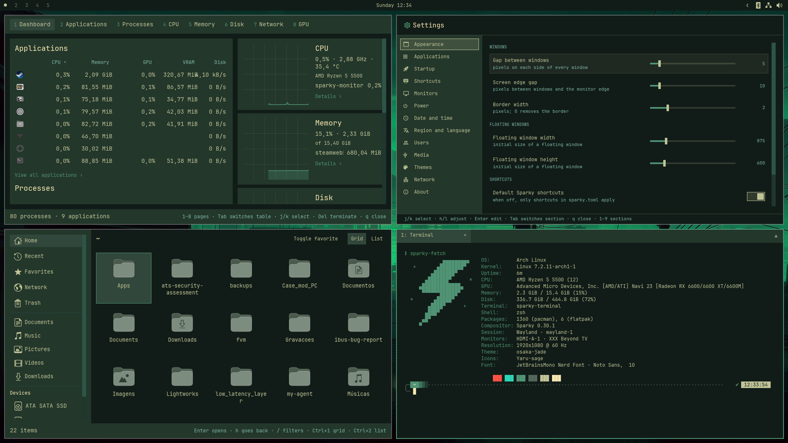
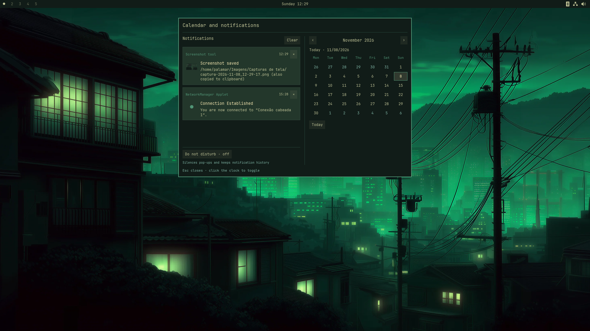
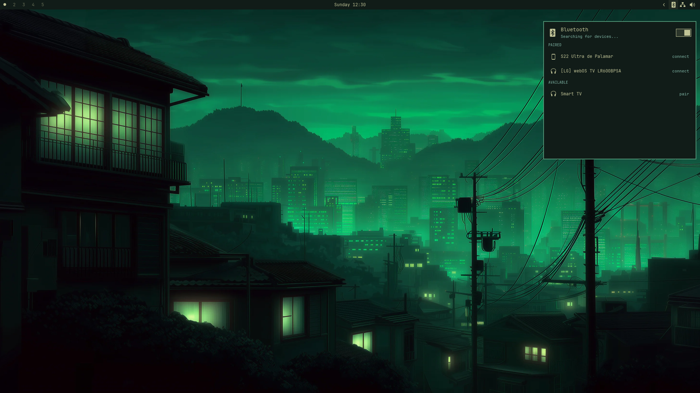
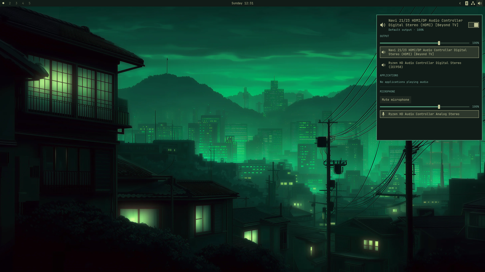

# Sparky

English | [Português (Brasil)](README.pt-BR.md)

Sparky is a keyboard-focused Wayland desktop environment written in Rust, with its own compositor. The mouse works too, but everything has a keyboard shortcut.

Only the themes, such as color palettes and wallpapers, come from [Omarchy](https://github.com/basecamp/omarchy).

## Screenshots










## Organization

| Path | Description |
|---|---|
| `crates/sparky-notifications` | Native freedesktop notification service, themed pop-ups, session history, and Do Not Disturb |
| `crates/sparky-bar` | Top bar (`sparky-bar`): workspaces, clock, and tray, one per monitor |
| `crates/sparky-compositor` | Wayland compositor (`sparky` binary), built with Smithay: protocols, windows, borders, keyboard, and pointer |
| `crates/sparky-tiling` | Tiling: dwindle tree, gaps, directional focus, floating windows, fullscreen, workspaces, and monitors. Independent of Wayland |
| `crates/sparky-config` | `sparky.toml` schema, Sparky defaults, actions, and default key bindings |
| `crates/sparky-ipc` | Sparky IPC protocol (one JSON message per line over a Unix socket), client used by the bar and applications, and `sparky-msg` |
| `crates/sparky-fetch` | System and session information in the terminal (`sparky-fetch`): Linux information read directly and Sparky information obtained over IPC, with visual, JSON, and plain-text output |
| `crates/sparky-hardware` | CPU, memory, and GPU information shared by sparky-settings and sparky-fetch |
| `crates/sparky-shot` | Screenshot tool (`sparky-shot`): mode picker, keyboard or mouse region selection, saved and copied PNG |
| `crates/sparky-files` | File manager (`sparky-files`): grid and list views with icons and thumbnails, context menus, devices, places, filtering, copy, cut, paste, rename, creation, compression, and trash |
| `crates/sparky-store` | Application store (`sparky-store`): Flathub first, with native repository fallback on pacman, APT, and DNF distributions |
| `crates/sparky-image` | Image viewer (`sparky-image`): opens PNG, JPEG, WebP, GIF, BMP, and TIFF, navigates folders, and supports keyboard zoom, panning, and rotation |
| `crates/sparky-monitor` | System monitor (`sparky-monitor`): application and process CPU, memory, GPU, VRAM, and disk use; resource graphs; and keyboard-driven process termination |
| `crates/sparky-storage` | Block volumes through udisksctl and MTP smartphones through udev/GIO/GVfs; disk parser shared with the panel |
| `crates/sparky-xdg` | Shared XDG conventions: user directories, installed `.desktop` files, application search, and theme icon resolution |
| `crates/sparky-settings` | Settings panel (`sparky-settings`): edits `sparky.toml` and applies changes immediately through IPC |
| `crates/sparky-ui` | Shared iced application components: keys, prompts, styles, numbered sidebar, scrolling, and windows |
| `crates/sparky-launcher` | Application launcher (`sparky-launcher`): searches installed `.desktop` files and launches them from the keyboard |
| `crates/sparky-terminal` | Default terminal (`sparky-terminal`): opens the user's shell with Sparky theme colors, font, and layout |
| `crates/sparky-keyring` | Keyring (`sparky-keyring`): stores application passwords in an encrypted vault and implements the D-Bus Secret Service API |
| `crates/sparky-keyring-prompt` | Vault password prompt (`sparky-keyring-prompt`) |
| `crates/sparky-login` | Login manager (`sparky-login`): system service that authenticates with PAM, registers the session with logind, and starts the user's session |
| `crates/sparky-login-greeter` | Login screen (`sparky-login-greeter`): clock, user, password, power controls, and session selection |
| `crates/sparky-login-core` | Protocol between the greeter and login service, installed Wayland session list, and login wallpaper selection |
| `crates/sparky-login-look` | Shared login and lock screen appearance: clock, fields, blurred wallpaper, colors, and icons |
| `crates/sparky-pam` | PAM authentication, dynamically loading libpam, used by login and lock |
| `crates/sparky-lock` | Lock screen (`sparky-lock`): clock, username, and password using ext-session-lock |
| `crates/sparky-lockd` | Lock daemon (`sparky-lockd`): handles logind lock requests and locks before suspend |
| `crates/polkit-sparky` | System authentication agent with a native window, themes, and polkit/PAM integration |
| `crates/sparky-theme` | Application color palette read from the theme's `colors.toml` |
| `data/themes` | Themes in `colors.toml` format |

## Tiling

Each new window splits the focused window's box: side by side if it is wider than it is tall, stacked otherwise, with the new window to the right or below. The split is preserved when the box is resized and can be toggled manually. Closing a window returns its space to its neighbor. Gaps are 5 px on each side between windows and 10 px at the screen edge (`Gaps::SPARKY`).

Workspaces range from 1 to 10, and each belongs to a monitor. Switching to a workspace visible on another monitor focuses that monitor; an empty workspace ceases to exist when it leaves the screen.

The scratchpad is an extra workspace displayed over the current one, like Hyprland's special workspace. `SUPER + S` (or `SUPER` plus the key left of 1) toggles it, and `SUPER + ALT + S` (or `SHIFT` with that key) moves the focused window into it. While open, new windows and focus go to the scratchpad and underlying windows do not respond to the mouse. Switching workspaces hides it, and it opens on the focused monitor. The `sparky.toml` actions are `toggle-scratchpad` and `move-to-scratchpad`.

Groups combine windows into one tiled frame with a title bar of tabs. `SUPER + G` groups the focused window or dissolves the group; `SUPER + ALT + G` removes a window; `SUPER + ALT` plus an arrow moves it into a neighboring group; `SUPER + ALT + TAB` and `SUPER + CTRL` plus an arrow cycle tabs; and `SUPER + ALT + 1` through `5` select a tab. A window opened from another window in a group joins that group. The `sparky.toml` actions are `toggle-group`, `leave-group`, `move-into-group` (with `direction`), `cycle-group` (with `step`), and `select-in-group` (with a 1-based `index`).

As in Omarchy, `SUPER` plus left mouse button drags a floating window or swaps a tiled window with the window on which it is dropped. `SUPER` plus right mouse button resizes from the corner nearest the pointer; in tiling, it moves the split. Windows cannot shrink below 120 × 80. Move and resize requests from applications themselves (client-drawn title bars, Wayland or X11) use the same path.

## Compositor

`sparky` is the Wayland compositor itself and does not depend on another. It supports xdg-shell (windows), wlr-layer-shell (bar, launcher, notifications), server-side decorations, clipboard (including primary selection and wlr-data-control), viewporter, cursor-shape (applications request named cursors such as text, hand, or resize), relative-pointer (raw mouse movement for games and 3D applications), pointer-constraints (applications can lock the pointer in place or confine it to a window), and ext-session-lock (lock screen).

X11 applications run through XWayland, which Sparky starts and controls using Smithay's X11 window manager. X11 windows enter the tiling layout like Wayland windows; unmanaged X11 menus and tooltips appear above everything; and clipboard and primary selection work in both directions. Programs launched by Sparky receive `DISPLAY` and `WAYLAND_DISPLAY`.

`SUPER + CTRL + L` locks the session using the locker configured in `[apps]` (`sparky-lock` by default, described under [Lock screen](#lock-screen); `swaylock`, `hyprlock`, and other ext-session-lock clients also work). While locked, only the locker is shown and receives input, shortcuts stop except `Ctrl+Alt+F1…F12`, and screenshots see only the locker. If the locker dies without unlocking, the session stays locked with a blank screen and a newly started locker can take over.

Normal windows are tiled. Dialogs with a parent, fixed-size windows, settings, and the screenshot tool float. The focused window's border uses the theme accent, and keyboard focus follows the pointer.

On a virtual terminal or through a login manager, `sparky` takes control of the GPU through the system session (libseat), arranges connected monitors left to right, tracks hotplugging, reads keyboard, mouse, and touchpad via libinput (tap-to-click enabled), and draws the `XCURSOR_THEME` cursor in the shape requested by each application. `Ctrl+Alt+F1…F12` switches virtual terminals.

To test inside another Wayland session, run Sparky in a window:

```bash
cargo run -p sparky-compositor -- --spawn kitty
```

`--spawn` can be repeated and starts each command inside Sparky. The keyboard layout comes from `/etc/vconsole.conf`, or `/etc/default/keyboard` on Debian.

## Configuration

Everything is configured in `~/.config/sparky/sparky.toml`; without this file, Sparky uses the defaults listed in full in `data/config/sparky.toml`. Sparky checks the file every second and applies changes without restarting (`sparky-msg reload` forces an immediate reload). Invalid files are rejected and the previous configuration remains active.

```toml
autostart = ["nm-applet"]

[general]
gaps_inner = 5
gaps_outer = 10
border = 2
default_binds = true

[input]
layout = "br"
variant = "abnt2"
repeat_rate = 40
repeat_delay = 250

[apps]
terminal = "kitty"

[[bind]]
keys = "SUPER + B"
action = "spawn"
command = "firefox"

[[bind]]
keys = "SUPER + H"
action = "focus"
direction = "left"

[[output]]
name = "DP-1"
scale = 1.5
```

A `[[bind]]` with the same key combination as a default binding replaces it; `default_binds = false` disables all default bindings. Actions: `spawn` (`command`), `close-window`, `toggle-floating`, `fullscreen` (`mode` = `monitor` or `maximized`), `toggle-split`, `focus` and `swap` (`direction` = `left`, `right`, `up`, `down`), `resize` (`width`, `height`), `workspace` (`workspace`), `move-to-workspace` (`workspace`, `follow`), `relative-workspace` (`step`), `previous-workspace`, `cycle-monitor` (`step`), and `exit`.

Each `[[output]]` configures a monitor by name (`sparky-msg outputs` lists the names): `scale` ranges from 0.5 to 4, including fractional values such as 1.25 or 1.5 (default: 1); `mode` specifies resolution and refresh rate, such as `"1920x1080@60.000"` (the preferred mode is used when omitted or unsupported); `rotation` is in degrees (0, 90, 180, or 270); `vrr = true` enables variable refresh rate on supported monitors; `enabled = false` turns off a display, but the last active display is never disabled.

`hdr = true` sends HDR10 (BT.2020 colors, PQ transfer function, static metadata, and 10 bits per color) to monitors whose EDID advertises PQ and BT.2020 and whose connector exposes `Colorspace`, `max bpc`, and `HDR_OUTPUT_METADATA`, provided the GPU supports FP16 composition. With HDR enabled, every frame on that monitor is converted to PQ: sRGB colors are converted to BT.2020 without oversaturation, and SDR white is set to 203 nits, the ITU-R BT.2408 reference value. These displays use neither direct scanout nor a hardware cursor plane, and screenshots remain SDR.

Applications describe their content's color through `wp-color-management-v1` (sRGB, called `compound_power_2_4` in version 2 of the protocol, gamma 2.2, extended linear, and PQ transfer functions; sRGB, BT.2020, Display P3, and DCI-P3 primaries; Windows scRGB). The compositor converts each window for its display: in HDR, HDR content uses its declared brightness up to the display peak reported by EDID (1000 nits if unavailable); in SDR and screenshots, values above white are clipped without tone mapping. At session startup, the display starts in SDR and switches to HDR when it presents its first frame. If an HDR frame fails or the display rejects it, Sparky returns to SDR without changing `sparky.toml`, logs the reason, and retries on each configuration reload, such as when enabling HDR in Displays. The Displays section of sparky-settings saves these options and only offers HDR on supported displays. Applications receive their scale through fractional-scale-v1 and render sharply at that scale; changing the scale rearranges monitors side by side.

Without `layout` in `[input]`, the system keyboard layout is used. Without `terminal` in `[apps]`, Sparky uses `$TERMINAL` or the first installed terminal, starting with `sparky-terminal`. `wallpaper` in `[general]` is the background image path (`~/` means the home directory); `wallpaper = ""` uses only the theme background color. If omitted, the first Tokyo Night wallpaper is used when `sparky-wallpapers` is installed. `wallpaper` in `[login]` sets the login screen wallpaper; when omitted, the desktop wallpaper is used.

## Session

Login managers (SDDM, GDM, etc.) list the **Sparky** session through `data/session/sparky.desktop`, installed in `/usr/share/wayland-sessions`, which starts `sparky` with `XDG_CURRENT_DESKTOP=sparky`. When running directly on hardware, Sparky:

- exports `WAYLAND_DISPLAY`, `DISPLAY`, `XDG_CURRENT_DESKTOP`, `XDG_SESSION_TYPE`, and `SPARKY_SOCKET` to D-Bus and systemd (`dbus-update-activation-environment --systemd`) so portals and activated services can find the session;
- restarts the user's `sparky-session.target`, which anchors `graphical-session.target`: portals (`xdg-desktop-portal`, `-wlr`, `-gtk`) and graphical services left over from an earlier session stop and restart attached to the current compositor, even when `systemd --user` persists between logins (linger);
- starts the keyring (`sparky-keyring`), authentication agent (`polkit-sparky`), lock daemon (`sparky-lockd`), native notifications (`sparky-notifications`), and bar (`sparky-bar`);
- runs XDG autostart entries (`~/.config/autostart` and `/etc/xdg/autostart`), respecting `Hidden`, `OnlyShowIn`, `NotShowIn`, `TryExec`, and `X-GNOME-Autostart-enabled`; a user file overrides a system file with the same name.

None of this happens when nested in another session. Portals use `data/portals/sparky-portals.conf` (GTK, wlr for screen capture, and `sparky-keyring` for passwords), installed in `/usr/share/xdg-desktop-portal`.

`polkit-sparky` displays system authorization requests, such as mounting internal partitions. Its native Sparky window uses the active palette, font, and square corners, with a password field, selection among users allowed by the system, Enter to confirm, Tab to switch controls, and Esc to cancel. The palette follows theme changes while the window is open.

Authentication uses the system polkit and PAM through `libpolkit-agent-1`; packages do not depend on another graphical agent. The requested password belongs to the account selected by polkit and is independent of the `sparky-keyring` vault password. The agent does not store it. Authentication cookies reach the window process through a private pipe, not command-line arguments. Requests are serialized and canceled when requested by the authority or when the session ends. Registration is limited to the current logind session. Automatic startup takes effect on the next Sparky login.

## Bar

A 26 px bar at the top of each monitor, like Omarchy's: workspaces on the left (1 through 5 always, the others up to 10 when they exist; the active one becomes a dot, empty ones are dimmed, and 10 appears as 0), the clock in the center, and the tray on the right. Clicking a workspace switches to it; right-clicking the clock toggles between `Wednesday 09:05` and `Wednesday, October 7, 2026`. The bar communicates with sparky over IPC and updates on every change.

The tray uses StatusNotifierItem over D-Bus. Left-click activates the application or opens its menu when the item advertises only a menu; right-click opens the menu. Selecting an enabled entry or pressing Esc closes the menu. The surface also closes when the item disappears or the menu becomes empty.

Symbolic icons from the active icon theme (Yaru in the bundled themes) follow the bar's color. Lookup respects theme inheritance and prioritizes symbolic network variants, preserving connection states; custom icons and pixmaps remain available as fallbacks. Network, Bluetooth, and items requesting attention remain visible. Other applications sit in a collapsible area: hovering over the arrow reveals the icons to the left, with a 600 ms transition and cubic ease-out; moving away collapses it, keeping the area open while its menu is visible. Each monitor has its own state, and the animation timer stops when the transition ends. Passive items are not shown.

The sound, network, and Bluetooth icons open native panels on left-click; clicking again or pressing Esc closes them. The panel stays open when another surface takes keyboard focus, such as the `sparky-shot` selection, so it appears in the screenshot. One panel appears at a time, on the monitor where the interaction occurred, with an opaque background, square corners, and the current Sparky palette. The rest of the tray retains application menus and the animated drawer. The bar provides its own audio and network indicators, avoiding duplicates from applets; the Bluetooth indicator appears only when an adapter is present.

The robot icon in the tray opens the Agents panel. It lists installed Claude Code, Codex, and Ollama models, including CLIs in the user's `~/.local/bin`; shows tokens observed today in local Claude and Codex session logs; and shows account usage limits when their own authenticated services respond. The plus button lists installed agents to open in `sparky-terminal`. A running Ollama model can be stopped from its card. Usage is refreshed when the panel opens and while it remains open, without requiring Omarchy or copying its account data. Missing limits are omitted rather than estimated.

The sound panel controls volume, mute, default output, microphone, and individual playback application volumes through the PulseAudio protocol, compatible with PipeWire-Pulse. The client does not open recording or playback streams. A compatible server must be running; the package requires the libpulse client library and recommends PipeWire-Pulse. State changes arrive through events rather than control subprocesses.

The network panel uses NetworkManager's D-Bus API to display interfaces, IPv4/gateway, connectivity, and Wi-Fi networks; it can enable/disable Wi-Fi, scan for networks, connect/disconnect, and select saved connections. While the panel is open, it reads interface traffic counters and measures ping and packet loss via ICMP to the IPv4 gateway. Ping uses an unprivileged ICMP datagram socket, permitted by systemd's default `net.ipv4.ping_group_range`; without that permission or a gateway, the panel shows "unavailable", and an unanswered request appears as "no response". New open, WPA2-Personal, and WPA3-Personal networks can be connected directly from the panel, with a password field and a remember option. Remembered profiles remain in NetworkManager's protected storage; temporary profiles use volatile persistence. A secret agent scoped to the requested connection handles password requests for that operation. Enterprise networks and other security modes require a previously configured profile; the panel does not configure VPNs or certificates. The Network settings button opens the Network section in sparky-settings, where you can select an active connection and choose between DHCP and manual IPv4. In DHCP mode, the section displays the IP address, gateway, and DNS received from the router, and any entered primary and secondary DNS servers can be used alongside or instead of those from DHCP; the profile's current choice is preserved. In manual mode, the IPv4 address/prefix, gateway, and primary and secondary DNS servers are editable, prefilled with what the router supplied, and validated before saving. Profiles with other IPv4 methods, such as shared or disabled, are not offered for editing. This editing uses NetworkManager's nmcli, preserves IPv6 properties and extra static addresses in a profile that remains on DHCP (leaving manual mode removes the manual address and gateway), and requests that the connection be reapplied; if reapplication is not possible, the saved configuration requires reconnection. Operations requiring privileges continue to use polkit-sparky, with the panel temporarily releasing the keyboard for authentication.

The Bluetooth panel uses BlueZ to enable/disable adapters, list devices, connect/disconnect, and pair new devices. Scanning lasts up to 15 seconds and ends only the discovery session started by the bar. The native pairing agent handles code confirmation, PIN, passkey, and authorization for operations initiated in the panel; it does not become the global default agent for external requests. After an approved pairing completes, it marks the device as trusted and requests a connection. Closing the panel cancels pending prompts and the client's own discovery session. Missing hardware, unavailable services, and operation failures appear in the panel. NetworkManager and BlueZ are recommended optional services; without them, the corresponding features are unavailable.

## IPC

sparky opens a socket at `$XDG_RUNTIME_DIR/sparky-<WAYLAND_DISPLAY>.sock` and exports its path in `SPARKY_SOCKET` to the programs it launches. Each request and each response is a line of JSON.

```bash
sparky-msg workspaces          # list workspaces
sparky-msg focus-workspace 3   # switch to workspace 3
sparky-msg subscribe           # notify on workspace and lock changes
sparky-msg reload              # reread sparky.toml
sparky-msg outputs             # list monitors and the focused one
sparky-msg info                # compositor version, session, theme, and current colors
sparky-msg capture output tela.png                 # the focused monitor
sparky-msg capture window janela.png               # the focused window, without its border
sparky-msg capture region 0 0 800 600 regiao.png   # region relative to the focused monitor
sparky-msg session lock        # same as the system menu options:
sparky-msg session suspend     #   lock, suspend, logout, reboot, and poweroff
sparky-msg session unlock      # ask the locker to unlock (SIGUSR1)
```

## Screen capture

sparky itself draws the requested area into an offscreen texture (the same windows and layers as on screen, without the cursor) and saves the PNG. The request arrives over IPC (`capture`), targeting the entire monitor, the focused window, or a region relative to a monitor; a region extending offscreen is clipped at the edge.

Third-party programs capture a monitor or an individual window through the `ext-image-copy-capture-v1` and `ext-image-capture-source-v1` protocols, with window listing through `ext-foreign-toplevel-list-v1`. The compositor renders directly into DMA-BUF on the GPU, and `xdg-desktop-portal-wlr` delivers the image to OBS and browsers through PipeWire. The native picker follows Sparky's theme. Packages include the portals and PipeWire as dependencies. Window capture requires wlr backend 0.8.0 or later; 0.8.4 or later is recommended. The `wlr-screencopy-unstable-v1` protocol remains compatible with `grim` and older backends, using SHM for screenshots and DMA-BUF for video. See [configuration, architecture, and performance validation](docs/SCREENCAST.md).

`sparky-shot` is the screenshot tool that uses this request:

| Shortcut | Command | Action |
|---|---|---|
| `PRINT` | `sparky-shot region` | Opens region selection on the focused monitor |
| `SHIFT + PRINT` | `sparky-shot window` | Captures the focused window |
| `CTRL + PRINT` | `sparky-shot output` | Captures the focused monitor |
| `SUPER + PRINT` | `sparky-shot` | Opens the picker: `R` for region, `J` for window, `M` for monitor, `Tab` changes the delay (none, 3, 5, or 10 s), `Esc` cancels |

During region selection, arrow keys move the area by 10 px (1 px with `CTRL`), `SHIFT` with arrow keys resizes it, `A` selects the whole screen, `Enter` captures, and `Esc` cancels. Dragging with the mouse draws a new area. The delay starts after selection, allowing time to open a menu.

The image is saved in `Capturas de tela` inside the pictures folder (`XDG_PICTURES_DIR`, or `~/Pictures`) as `captura-AAAA-MM-DD_HH-MM-SS.png`, copied to the clipboard through `wl-copy`, and a notification reports its location (`notify-send`).

## Launcher

`sparky-launcher` opens with `SUPER + SPACE`: a box in the center of the screen with search already focused and a list of installed applications, named in the system language. Typing filters the list (name prefixes first, then word prefixes, name substrings, keywords and description, and finally letters in order, such as `ffx` for Firefox); arrow keys, `Tab`/`SHIFT + Tab`, or `CTRL + N`/`P` (or `J`/`K`) select; `Enter` opens and `Esc` closes. Clicking also opens an application. The list comes from `.desktop` files in `~/.local/share/applications` and the `XDG_DATA_DIRS` directories (including Flatpak), respecting `NoDisplay`, `Hidden`, `OnlyShowIn`/`NotShowIn`, and `TryExec`; terminal applications open in the selected terminal, which sparky passes to programs in `TERMINAL`.

### System menu

`SUPER + ESC` opens `sparky-launcher --system` (`system_menu` in `[apps]`), with the same keys as the launcher and five options in this order:

| Option | Action |
|---|---|
| Lock | Opens the locker from `[apps]` if the screen is not already locked |
| Suspend | Locks and suspends (`systemctl suspend`) as soon as the screen locks; if the locker does not lock within 5 seconds, suspends anyway |
| Log out | Asks all windows to close and exits sparky when the last one closes |
| Restart | Closes windows the same way and runs `systemctl reboot` |
| Power off | Closes windows the same way and runs `systemctl poweroff` |

Log out, Restart, and Power off wait for applications to close on their own, like hyprshutdown: none are forcibly terminated. If any window remains open after 8 seconds (an application asking whether to save, for example), the request is canceled and a notification reports how many remain; `SUPER + SHIFT + ESC` still exits immediately. When sparky is nested in another session, Suspend, Restart, and Power off are rejected so a test never shuts down the machine; Lock and Log out work.

## Terminal

`sparky-terminal` is the default terminal: sparky looks for it before other installed terminals, so it opens with `SUPER + ENTER` and for terminal applications in the launcher. It launches zsh with sparky's own configuration (`ZDOTDIR=/usr/share/sparky/zsh`), without reading the user's `~/.zshrc`, oh-my-zsh, or powerlevel10k; it is ready to use on a new machine. To customize it, copy the folder to `~/.config/sparky/zsh/` (respecting `XDG_CONFIG_HOME`): with a `.zshrc` there, it replaces the system configuration. Without zsh installed, it launches the account's shell. The shell receives `TERM=xterm-256color`, `COLORTERM=truecolor`, and `TERM_PROGRAM=sparky-terminal`. With `fetch_on_start = true` in `[terminal]` in `sparky.toml` (disabled by default), each tab that launches the shell first displays `sparky-fetch` at the tab's width; tabs using `-e comando` do not, and if `sparky-fetch` is missing, fails, or takes longer than 1.5 s, the tab opens normally without it.

The configuration (`data/zsh/`) reproduces powerlevel10k's *rainbow* setup in pure zsh, using the theme's colors:

- a two-line prompt with a `╭─`/`╰─` frame, the directory in blue, git in green (clean) or yellow (with changes) with the branch, `⇣⇡`, `*` stash, `~` conflicts, `+` staged, `!` modified, and `?` new files, a dotted line to the right, `✔` or `✘ code`, command duration from 3 seconds onward, background jobs, and the time; after execution, the previous prompt shrinks to `❯`;
- 50,000 lines of history in `~/.local/state/sparky/zsh_history`, case-insensitive menu completion, arrow keys searching by the beginning of the line, and `CTRL + ←/→` moving by word;
- git aliases (`gst`, `gco`, `gcb`, `gaa`, `gcmsg`, `gp`, `gpsup`, `glog`, and others following oh-my-zsh conventions), `copyfile`, `CTRL + O` to copy the line (copybuffer), `ALT + ←/→/↑` to go back, forward, and up between directories (dirhistory), `google`, `ddg`, `github`, `youtube`, `wiki`, and `stackoverflow` (web-search), plus autojump and fzf when installed;
- `zsh-autosuggestions` and `zsh-syntax-highlighting` from distribution packages, which sparky installs alongside it.

Emulation (PTY, VT/xterm sequences, 10,000 lines of history, and selection) comes from the `alacritty_terminal` library; the window, cell rendering, keyboard handling, and colors are sparky's. Text uses JetBrainsMono Nerd Font at 12 px, with an 18 px margin and sparky's square corners, and cell measurements use the same text engine as rendering so columns stay aligned. Bold, italic, underline, strikethrough, inverse, dim, 256 colors, truecolor, wide characters, and Nerd Font glyphs appear as they do in kitty.

Colors follow sparky's theme, including while the terminal is open: the 16 ANSI colors come from `colors.toml` in the same order Omarchy uses in kitty (`background`, `red`, `green`, `yellow`, `blue`, `magenta`, `cyan`, `foreground`, `muted`, and the `bright_*` colors), the cursor and selection use `bright_foreground` and `selection`, and applying another theme in the settings panel recolors the terminal within one second. Colors changed by a program (OSC 4, 10, 11, and 12) remain until the program resets them.

| Key | Action |
|---|---|
| `CTRL + SHIFT + C` or `CTRL + INSERT` | Copies the selection |
| `CTRL + SHIFT + V` or `SHIFT + INSERT` | Pastes between bracketed paste markers when requested by the program, preventing pasted text from closing the block |
| `SHIFT + PGUP` / `SHIFT + PGDN` | Scrolls history by one page |
| `SHIFT + HOME` / `SHIFT + END` | Goes to the beginning or end of history |
| `CTRL + SHIFT + T` | Creates a tab with a new shell |
| `CTRL + SHIFT + Q` | Closes the current tab |
| `CTRL + SHIFT + ←/→` | Switches tabs, wrapping at either end |
| Middle-click | Pastes the primary selection |
| `SHIFT + ENTER` / `ALT + SHIFT + ENTER` | Sends `\e[13;2u` / `\e[13;4u`, as in kitty |

Dragging with the left mouse button selects text; releasing it publishes the text to the primary selection, separate from the `CTRL + SHIFT + C/V` clipboard. Clicking the wheel pastes that selection, including when it comes from another application. The wheel scrolls history. When a program requests mouse events, it receives wheel events with cell coordinates in the requested format (SGR, UTF-8, or legacy), in both the main and alternate buffers. Without such a request, the wheel in the alternate screen (`less`, `man`) continues to generate arrow keys. Fractional movements accumulate until they reach a full line. Typing returns to the end of history and clears the selection. The window title comes from the active tab's shell. Each tab keeps its own PTY, history, selection, and scroll position, and programs continue running in inactive tabs. A shell exiting closes only its tab; closing the last tab exits the window. An asynchronous paste remains bound to the tab that requested it and is discarded if that tab has already closed.

```bash
sparky-terminal                       # the user's shell
sparky-terminal -d ~/Projetos         # starting in this directory
sparky-terminal -e htop               # run a command; the rest of the line is its arguments
```

The tab bar uses Sparky's font, colors, and square corners, and follows theme changes live. Click a title to switch, `×` to close, or `+` to create. Many tabs can be browsed with horizontal scrolling; a tab selected by keyboard is brought into view. The first tab respects `-e` and `-d`; subsequent tabs launch Sparky's shell in the initial directory selected by `-d`, when provided. Tab shortcuts are handled by the terminal before being sent to the PTY; `CTRL + C` still interrupts commands. Window splits remain handled by Sparky's tiling and groups. Mouse forwarding to programs covers only the vertical wheel; clicks and drags remain dedicated to terminal selection and pasting. The kitty keyboard protocol is not yet implemented.

## sparky-fetch

`sparky-fetch` displays system and session information in the terminal, with the Sparky logo alongside it. For Linux, it reads directly from the system: OS, kernel, uptime, CPU, GPU, memory, disk, terminal, shell, and packages (pacman, dpkg, rpm, and flatpak). For Sparky, it queries the compositor over IPC: version, Wayland session, monitors, resolution, theme, and theme colors. Icons and font come from the GTK settings written by sparky-settings. Outside a Sparky session, or when the compositor does not respond, Linux information is still displayed.

```bash
sparky-fetch                                # in a terminal: visual and colorful; in a pipe: plain text
sparky-fetch --json                         # all fields, with each field's status
sparky-fetch --fields os,kernel,memory      # choose fields and their order (--list-fields lists all)
sparky-fetch --hide gpu,packages --no-logo
sparky-fetch --layout stacked --width 60 --accent '#ff9e64'
```

Configuration lives in `~/.config/sparky-fetch/config.toml` (respecting `XDG_CONFIG_HOME`); command-line options override the file, and the file overrides defaults. `--config` uses another file and `--no-config` reads none.

```toml
fields = ["os", "kernel", "cpu", "memory", "compositor", "theme", "colors"]
hide = ["gpu"]
format = "visual"      # visual, json, or plain
color = "auto"         # auto, always, or never (NO_COLOR also disables it)
logo = true
layout = "classic"     # classic (logo alongside) or stacked (logo above)
width = 90
timeout_ms = 400

[colors]
accent = "#7aa2f7"     # logo and labels; without it, the theme's accent is used
label = "#7aa2f7"
value = "#c0caf5"
```

In visual mode, the logo moves above the information when the width cannot fit both side by side, and disappears when even the logo does not fit; long values are truncated with `…`. In JSON, each field includes `status`: `ready` (with `value`), `unavailable` (with `reason`: `missing`, `no_compositor`, `unsupported`, or `uncollected`), `timed_out`, or `failed` (with `error`); in visual and plain-text output, anything that is not ready appears as `N/A`. Collection runs in parallel, with up to four collectors at once and an overall deadline (`timeout_ms`, 400 ms by default); anything that does not respond in time becomes `timed_out` without holding up the rest. A compositor predating the IPC `info` request returns only monitors and resolution, and the other Sparky fields become `unsupported`. To have `sparky-terminal` open each tab with `sparky-fetch`, use `fetch_on_start = true` in `[terminal]` in `sparky.toml` (see [Terminal](#terminal)).

## Keyring

`sparky-keyring` stores passwords and tokens that applications ask to remember (browsers, VS Code, git with `libsecret`, email clients). It owns the `org.freedesktop.secrets` name on the session D-Bus with the Secret Service API, the same one used by gnome-keyring, so applications work without configuration. For Flatpak applications, it also provides the secrets portal (`data/portals/sparky-keyring.portal`).

- The vault lives at `~/.local/share/sparky/keyrings/login.json` (respecting `XDG_DATA_HOME`), with an owner-only directory (700) and file (600). Each write replaces the file atomically, never leaving a partially written vault.
- Contents are encrypted with XChaCha20-Poly1305 using a key derived from the password with Argon2id (64 MiB, 3 passes). Labels, attributes, and secrets are stored only in encrypted form; to allow searching while the vault is locked, the file stores a SHA-256 digest of each attribute, protected against tampering together with the contents.
- The vault has its own password, separate from the login password. The first time an application wants to store something, `sparky-keyring-prompt` asks you to create a password (twice, to confirm); afterward, the first time in each session that an application needs a stored password, it asks you to unlock the vault. A wrong password prompts again; `Esc` cancels and the application receives a refusal.
- The vault stays unlocked until the session ends: when the compositor closes, `sparky-keyring` exits and the key is removed from memory.
- There is a single vault, the default (`default`/`login`). Password transport over D-Bus uses the specification's `plain` algorithm; applications requesting the encrypted algorithm receive a refusal and retry with `plain`, as required by the specification.

If another keyring (gnome-keyring, KWallet) already owns `org.freedesktop.secrets` when the session starts, `sparky-keyring` logs a warning and does not start; passwords remain with the other keyring. Passwords already in gnome-keyring are not copied: each application asks you to log in once within sparky.

## Login screen

`sparky-login-greeter` is sparky's own login screen, designed to replace SDDM, GDM, and similar tools. On the left, occupying 40% of the width, are the 12-hour clock (`06:19 PM`), date (`Monday 2 November`), username, password, **Login** button, **Power off**, **Restart**, and **Suspend** buttons, and session (`Session (Sparky)`); this strip has a lightly blurred wallpaper background, with the wallpaper covering the screen without distortion. Sizes scale with screen height (at 1080 lines, the clock is 156 px and the fields are 39 px), and colors come from sparky's theme.

- The username is lowercase; with the last user already filled in, focus starts in the password field.
- `Tab` and `SHIFT + Tab` move through username, password, Login, power controls, and session; `Enter` activates the focused control, and advances to the next option in the session selector.
- The eye in the password field shows and hides the entered text.
- Sessions come from `.desktop` files in `wayland-sessions` under `$XDG_DATA_DIRS` (without the variable, `/usr/local/share` and `/usr/share`), excluding hidden and uninstalled sessions; the first directory wins when a filename is repeated, and Sparky is used when there is no preference.
- A wrong password clears the password and displays `Login failed!` above the username.

The selected session is saved together with the user: both are preselected at the next login.

### Login service

`sparky-login` is the system service that replaces SDDM and GDM. It runs as root through `sparky-login.service`, occupies terminal 1, and launches the compositor in restricted mode (`sparky --login-screen sparky-login-greeter`) for each login screen, as the `sparky-login` system user in a logind session of class `greeter`. In this mode, the compositor has no shortcuts, autostart, IPC, or XWayland; only terminal switching (`CTRL + ALT + F1` through `F12`) remains available, and it exits when the login screen closes.

- The screen communicates with the service through `/run/sparky-login/greeter.sock`, accessible only to the `sparky-login` user (0600, checked against the peer process credentials).
- Each login attempt runs in its own process (`sparky-login --worker`), which authenticates through the `sparky-login` PAM service (`pam_authenticate` and `pam_acct_mgmt`). Wrong passwords, unknown users, and too many attempts produce the same refusal; expired passwords or accounts explain the reason.
- With the correct password, the service saves the user and session in `/var/lib/sparky-login/memory.json`, waits for the screen to close, and starts the session: `XDG_SESSION_TYPE=wayland`, `XDG_SESSION_CLASS=user`, `XDG_SEAT=seat0`, `XDG_VTNR`, `XDG_SESSION_DESKTOP` (the `.desktop` name), and `XDG_CURRENT_DESKTOP` (its `DesktopNames`) for `pam_systemd`, PAM credentials and session, and the session's `Exec` through the user's login shell (`$SHELL -l -c`), with the user's groups, gid, and uid already set and the terminal as its controlling terminal.
- When the session ends, the service closes the PAM session and opens the login screen again. If the screen crashes, it restarts automatically; if it does not close after login, it receives `SIGTERM` after 10 s.
- Power off, Restart, and Suspend send requests to logind (`PowerOff`, `Reboot`, `Suspend`).
- The dedicated PAM configuration does not start gnome-keyring: within sparky, passwords are managed by `sparky-keyring`.
- The screen uses the colors and wallpaper of the last user to log in. At the beginning and end of each session, the service reads, with the user's own permissions, the theme's `colors.toml` and the image selected for the login screen (the desktop image if none was selected), and stores a copy in `/var/lib/sparky-login/appearance`, readable only by root and the login screen. The image must be a regular file no larger than 32 MiB. Without the copy, the default theme and wallpaper are used.

Packages install the service, user (`sysusers.d`), screen directory (`tmpfiles.d`), and both PAM files (`/etc/pam.d/sparky-login`, tailored to each distribution, and `/etc/pam.d/sparky-login-greeter`), but do not enable the service. To replace SDDM with sparky-login:

```sh
sudo systemctl disable sddm
sudo systemctl enable sparky-login
sudo reboot
```

To switch back, enter a terminal with `CTRL + ALT + F2`, log in, and run `sudo systemctl disable sparky-login && sudo systemctl enable sddm && sudo reboot`. The service log is in the journal: `journalctl -u sparky-login -b`.

The preview opens in any Wayland session with layer-shell: `sparky-login-greeter --preview [--wallpaper <imagem>]`. Without `--wallpaper`, the default theme's first wallpaper is used. In preview mode, no password is accepted, power buttons do nothing, and `Esc` closes the screen; on the real login screen, `Esc` does not close anything.

## Lock screen

`sparky-lock` is sparky's default lock screen (`locker` in `[apps]`), opened with `SUPER + CTRL + L` and Lock in the system menu. It has the same appearance as the login screen: clock, date, blurred strip on the left, a fixed username, and password field, without a session selector or power buttons. Colors come from sparky's theme and the wallpaper is the login screen's (`[login] wallpaper`; without it, the desktop wallpaper).

- The same screen appears on every monitor, and the password entered on any of them is accepted.
- `Enter` or **Unlock** checks the password through the `sparky-lock` PAM service (on Arch and Fedora, `auth include login`; on Debian, `common-auth`). A wrong password clears the field and shows `Incorrect password!`; PAM's own messages, such as an account locked after too many attempts, replace that notice.
- `Esc` clears the entered password; the eye shows and hides it.
- Locking uses the ext-session-lock protocol: the compositor displays only the lock screen, shortcuts stop working, and screenshot requests are rejected. If `sparky-lock` crashes, the session stays locked; to unlock, enter a terminal (`Ctrl+Alt+F2`) and run `WAYLAND_DISPLAY=wayland-1 sparky-lock` (use the session's `WAYLAND_DISPLAY` number), then return with `Ctrl+Alt+F1`.

`sparky-lockd` starts with the session and connects locking to logind:

- `loginctl lock-session` (and anything requesting a lock through logind) opens the locker; `loginctl unlock-session` asks the locker to unlock by sending it `SIGUSR1` (`sparky-lock`, `swaylock`, and `hyprlock` unlock on this signal).
- Before suspending through any path (menu, `systemctl suspend`, laptop lid), it holds off suspension with a logind delay inhibitor until the screen is locked; if locking does not happen within 5 seconds, suspension proceeds anyway.
- The session's `LockedHint` in logind follows the lock state, letting other programs know the screen is locked.
- The compositor announces locking and unlocking over IPC (`sparky-msg subscribe` shows `locked` and `unlocked`) and accepts `sparky-msg session unlock`.

The session also locks automatically after a period without keyboard or mouse input: `idle_minutes` in `[lock]` (10 minutes by default; `0` disables it), also adjustable in the Power section of sparky-settings (Never, 1, 2, 5, 10, 15, or 30 minutes, or 1 hour). While a program requests that the screen stay on, such as a browser or player playing video, idle time does not trigger locking: this supports both the idle-inhibit protocol and the `org.freedesktop.ScreenSaver` service (`Inhibit`/`UnInhibit`) provided by `sparky-lockd` in the session, used by Firefox, Chrome, VLC, and the `xdg-desktop-portal` portal; a request disappears automatically when the requesting program exits. The compositor also provides ext-idle-notify so programs such as `swayidle` can detect when the session is idle.

## Files

`sparky-files` opens with `SUPER + SHIFT + F` (or `sparky-files <folder>`). It opens in a grid, with icons and names for folders and files, and can switch to a list with size and date using the Grid/List buttons or `CTRL + 1`/`CTRL + 2`. The grid adapts to the window width; folders come first, and the view updates when the folder changes. Switching views preserves the filter, selection, and marked items.

Icons follow the theme configured by the settings panel in GTK, including its inheritance (`index.theme`). The file manager prefers the theme sizes closest to 96 px, including double-scale folders (`48x48@2x`), to keep icons from looking blurry. Special folders and common file types have their own icons; without an installed icon, sparky draws a fallback icon. Changing the theme updates the icons without closing the file manager.

PNG, JPEG, and WebP images display a content thumbnail instead of an icon. Thumbnails are generated in the background, two at a time and only for visible items, from files up to 16 MiB and 8192 px per side. They stay in memory and are regenerated when the file changes; nothing is written to disk. Larger files or files that cannot be read keep their file-type icon.

The sidebar also provides access to the **Trash**. It shows items from `~/.local/share/Trash/files`, including those sent there by other applications. Select an item and use **Restore item** at the top or in the context menu to return it to the path recorded in its `.trashinfo`; **Restore all** returns all items in the trash, including those hidden by the filter. **Empty trash** asks for confirmation before permanently deleting all items, including those hidden by the filter. If the destination already exists or the record is missing/invalid, the item stays in the trash and an error is displayed. Inside the trash, creating, renaming, cutting, pasting, and moving to the trash again are unavailable; restore the item before opening it.

The sidebar contains places and devices: SSDs, partitions, and removable drives with a filesystem, whether mounted or not. The list updates every two seconds. Clicking opens a mounted volume; if unmounted, it requests mounting through `udisksctl` and opens the returned mount point. The unmount button is separate and never forces the operation. `ALT + 1` through `9` mount/open the corresponding devices; `ALT + U` requests unmounting the open volume. Mounting depends on `udisks2` and system permissions; refusals and busy devices appear as warnings. Queries use `lsblk` (`util-linux`). System partitions, swap, and encrypted containers that are still locked are not offered for mounting/unmounting. Removing the volume being browsed returns the file manager to the home folder.

Android smartphones in file transfer mode also appear in the sidebar, with a phone icon and an MTP indicator. Discovery uses udev USB records and does not mount automatically. Clicking connects through GIO/GVfs, reusing existing access and opening its FUSE path inside sparky-files itself. The unmount button ends that access without forcing it. The phone must be unlocked and allow file transfer; devices in charging mode and iPhones are not covered by this MTP support.

The backend depends on `gvfs-mtp` on Arch and Fedora; on Debian/Ubuntu, it depends on `gvfs-backends` and `gvfs-fuse`. Fedora also requires `gvfs-fuse`; on Arch, FUSE access is already part of `gvfs`. The packages declare these components as optional/recommended dependencies, maintaining the policy used for udisks2. There is no need to run another file manager. Access failures, a missing backend, and a busy phone appear as warnings, and the wait for asynchronous mount/unmount operations is limited to 30 seconds.

When polkit requires authentication, the session's graphical agent asks for the password. The file manager remains responsive while waiting and allows another attempt after cancellation. `udisksctl` runs without the session's controlling terminal, through `setsid` from `util-linux`, to avoid invisible password prompts in the terminal. Tooltips have an opaque background using the theme colors.

Periodic device queries do not display a refresh indicator. The sidebar shows progress only during mounting and unmounting, keeps error warnings, and preserves the empty-list message during queries.

| Key | Action |
|---|---|
| `j` `k` or `↑` `↓` | Move down and up one grid or list row |
| `←` `→` | In the grid, select the neighboring item; in the list, go back/open |
| `Enter` or `l` | Open the folder or file (in the default application, through `xdg-open`) |
| `h`, `Backspace`, or `ALT + ↑` | Go to the parent folder, with the previous folder selected |
| `g` / `G`, `Home` / `End`, `PageUp` / `PageDown` | Beginning, end, and pages |
| `1` through `9` | Go to the place with that number |
| `/` | Filter by name while typing; `Enter` keeps the filter, `Esc` clears it |
| `.` or `CTRL + H` | Show or hide hidden items |
| `Space` | Mark the item and advance; actions apply to marked items or, if none are marked, to the selected item |
| `y` / `x` / `p` (or `CTRL + C` / `X` / `V`) | Copy, cut, and paste; pasting in the same folder creates `name (copy).ext` |
| `r` or `F2` | Rename, with the name excluding its extension already selected |
| `a` | Create: `name/` becomes a folder; without the slash, it becomes an empty file |
| `d` or `Delete` | Move to the trash (`~/.local/share/Trash`, with `.trashinfo`), after confirming with `Enter` |
| `F5` or `CTRL + R` | Reread the folder |
| `q` or `CTRL + Q` | Close |

| `CTRL + SHIFT + N` | Create a folder, with the suggested name selected |
| `CTRL + A` | Mark all visible items |
| `ALT + Enter` | Show properties for the selected item or, without a selection, for the open folder |

With the mouse, one click selects, a double-click opens, and the wheel scrolls the list.

Right-click opens a context menu in the theme colors. On a file or folder, it offers open, open with another application, cut, copy, move to, copy to, rename, compress, email, move to trash, and properties. In an empty area, it offers new folder, new document, open the folder with another application, paste, select all, and properties. If the item is already marked, the menu acts on all marked items. While a menu or dialog is open, keys do not act on the list; `Esc` or a click outside closes it.

- **Open with** lists the applications registered for the file type, through GIO.
- **Move to** and **Copy to** ask for the destination folder path in the bottom bar (accepting `~` and relative paths) and do not change the clipboard.
- **Compress** creates a `.tar.gz` in the open folder through `tar`, without freezing the window. The archive is written to a temporary file and never replaces an existing item.
- **Email** opens the default email client through `xdg-email`, with the files attached; folders must be compressed first.
- **Properties** shows the name, type, path, size, modification date, and permissions.

When copying a single PNG, JPEG, or WebP image, `sparky-files` also publishes its bytes to the system clipboard. This allows `CTRL + V` in another application to paste the image; file copying within the file manager remains available.

## Store

`sparky-store` opens the Flathub catalog for browsing and searches Flathub first using Flatpak's AppStream catalog. If Flathub has no match or is unavailable, it searches the native repositories of the detected distribution: pacman on Arch derivatives, APT on Debian derivatives, or DNF on Fedora/RHEL derivatives. The source selector can request native packages directly. If Flatpak is installed but Flathub is absent, the store offers to add the Flathub remote to the current user. The Installed view lists Flathub apps and explicitly installed native packages. Searches, refreshes, and package operations run in the background; the window follows Sparky's theme colors while open.

Select an item to install, update, or remove it. Each operation asks for confirmation. Flatpak uses the matching user or system installation; native operations use `pkexec`, so polkit-sparky can request authentication. On Arch, the Update action uses a full `pacman -Syu`, because updating one package alone could leave a partially upgraded system; the confirmation panel states this scope. Flatpak is an optional package dependency so the store can still use the native repositories when it is not installed. The store does not add a native repository or perform package changes merely by browsing.

The Updates view checks installed Flatpak applications and runtimes in both user and system installations, including their extensions, and lists native package upgrades separately. It shows installed and available versions when the package manager provides them, keeps source failures visible, and offers per-item, per-source, and sequential Update all actions with confirmation. On Arch, the native action always runs one full `pacman -Syu`; the `pacman-contrib` dependency supplies `checkupdates`, which checks a separate package database without partially refreshing the system database. On Debian derivatives, the initial check uses cached APT indexes and Refresh asks permission to update those indexes; upgrades may add dependencies but do not remove installed packages. The store does not manage AUR packages or distribution version upgrades, and does not reboot automatically.

## Images

`sparky-image` is the native image viewer. It opens through `sparky-files` (or `sparky-image <file or folder>`) and displays PNG, JPEG, WebP, GIF, BMP, and TIFF using the active theme's palette and font, following theme changes. The image fits the window without enlarging small images, and photos with EXIF orientation are shown upright. The status bar shows the name, position in the folder, dimensions, and zoom.

| Key | Action |
|---|---|
| `←`/`→` or `h`/`l` | Previous and next image in the folder, in the same order as `sparky-files` (when zoomed, pan the image) |
| `↑`/`↓` or `k`/`j` | Pan the image when it extends beyond the window |
| `Space`/`Backspace`, `PageDown`/`PageUp` | Next and previous, even when zoomed |
| `Home`/`End` | First and last image |
| `+`/`-` | Zoom in and out (also available through the mouse wheel) |
| `0` / `1` | Fit to window / actual size |
| `r` / `SHIFT + R` | Rotate 90° clockwise / counterclockwise, in the view only |
| `q` or `Esc` | Close |

When zoomed, dragging with the left button pans the image. Decoding runs outside the UI and rejects images above 16384 pixels per side; corrupted files or unsupported formats display the reason on screen. Animated GIFs show the first frame.

## System monitor

`sparky-monitor` checks the computer every second, using the active theme's palette, font, and square corners. The dashboard shows **Applications** and **Processes** tables on the left and CPU, memory, disk, network, and GPU cards on the right, with a graph of the last 60 seconds, current values, and the process using the most of each resource. Each card leads to a details page, with scaled graphs, resource figures, and processes sorted by that resource: CPU cores, frequency, and temperature; memory and swap; capacity, usage, reads, writes, and temperature for each disk; traffic per network interface; usage and VRAM for each GPU.

Data comes from `/proc` and `/sys`, read outside the UI. Applications are processes grouped by the installed `.desktop` file whose program launched them, including child processes in the totals (Firefox tabs count toward Firefox). Per-process GPU and VRAM usage comes from DRM clients' `fdinfo`, available on AMD and Intel; per-process disk activity comes from `/proc/<pid>/io`, readable only for the user's own processes. Network activity is not measured per process.

| Key | Action |
|---|---|
| `1` through `8` | Dashboard, Applications, Processes, CPU, Memory, Disk, Network, and GPU |
| `Tab` | Switch between the application and process tables on the dashboard |
| `j`/`k` or `↓`/`↑`, `Home`/`End` | Select the application or process (also available through the mouse wheel) |
| `c` `m` `g` `v` `d` `n` | Sort by CPU, memory, GPU, VRAM, disk, or name; repeat to reverse |
| `Delete` / `SHIFT + Delete` | Terminate (SIGTERM) or force-kill (SIGKILL) the selected entry, after confirming with `Enter` |
| `Esc` or `Backspace` | Cancel confirmation or return to the dashboard |
| `q` | Close |

Terminating an application sends the signal to all its processes. Each process is identified by its PID and start time and is pinned by `pidfd` when the confirmation appears; if it exits before `Enter`, no other process reusing the PID receives the signal. Other users' processes can only be terminated with permission; a refusal appears in the status bar.

## Settings

`sparky-settings` opens with `SUPER + ALT + SPACE`. Changes to sparky settings are written immediately to `~/.config/sparky/sparky.toml`, changing only the affected key (file comments are preserved), and sparky reloads through IPC. If sparky is not running, the change takes effect when it starts. System sections run the corresponding tools and show the result or error without writing to TOML.

| Section | What it changes |
|---|---|
| Appearance | Gaps, border thickness, floating window size, default shortcuts, and wallpaper |
| Applications | Terminal, launcher, files, settings, screenshot tool, and screen locker opened by shortcuts |
| Startup | Commands run when the session starts |
| Shortcuts | List of shortcuts in use, with what each one does |
| Monitors | Monitor position layout and, for each monitor, resolution, scale, rotation, variable refresh rate, and whether the display stays on, saved in `[[output]]`, plus HDR, shown only on displays that support it |
| Power | Power profile (`powerprofilesctl`), screen brightness (`brightnessctl`), battery (`upower`), and idle time before locking the screen (`[lock] idle_minutes`) |
| Date and time | Time zone, local time, network synchronization, and hardware clock (`timedatectl`) |
| Region and language | Language, console keyboard, and system default layout (`localectl`), plus session key repeat (`[input]` in `sparky.toml`, applied immediately) |
| Users | Account, identifier, group, and session queries (`getent` and `loginctl`) |
| Media | External volumes, mounting, and unmounting (`lsblk` and `udisksctl`) |
| Themes | Current theme and theme wallpaper, selected from lists |
| Network | Active connection, DHCP or manual IPv4, and DNS (`nmcli`) |
| About | sparky version, system, kernel, computer, processor, GPUs, and total RAM |

The window has a header, a sidebar with an icon for each section, and items grouped under labels. `Tab` and `SHIFT + Tab` (or `1` through `9`) switch sections, `j`/`k` select an item, `h`/`l` adjust numbers, toggle switches, or move to the neighboring list option, `Enter` edits text or a number and allows typing a list value, `d` removes a startup command, `Esc` cancels editing, and `q` closes; the footer shows the keys for each section. The mouse also works: sliders (the value is saved on release), switches, dropdown lists that filter as you type, options marked with ✓, buttons such as Mount/Unmount, and double-clicking in Startup.

In Date and time, `Enter` or clicking the time zone opens editing; the name must exist in the output of `timedatectl list-timezones`. Local time is read-only. `Enter` or `h`/`l` toggle network time and the use of local time for the hardware clock; without an available NTP service, the network row is read-only. `F5` refreshes the data. Changes depend on system permissions, and refusals appear in the panel's warning area.

In Region and language, `h`/`l` cycle through installed options, and `Enter` or a click allows typing a value from the `localectl` list. Without available options, the row is read-only. These values are system defaults; the Sparky session keyboard is still configured in the Keyboard section. Language changes may require a new session for applications to adopt the value.

Users shows one account at a time, navigable with `j`/`k` or the side buttons: name, UID, type, session, home folder, shell, and groups. It recognizes administrators in the `wheel` and `sudo` groups; if a query fails, the data appears as unavailable. As in the example panel, this section is read-only: it does not create accounts or change passwords or groups. `F5` refreshes the query. Sections after the ninth remain accessible through `Tab`, `SHIFT + Tab`, and sidebar clicks.

Media lists filesystems on external/removable disks and volumes under `/run/media` or `/media`, with their label, size, and mount point. `Enter` or a click toggles mounting; `l` mounts, `h` unmounts, and `F5` rereads the list. Mounting uses `udisksctl` (the `udisks2` package) and system permissions. Swap, partitions without a filesystem, and system mounts are not offered.

## Theme

Colors come from the first file that exists:

1. `~/.config/sparky/colors.toml`
2. `$SPARKY_PATH/themes/tokyo-night/colors.toml` (`SPARKY_PATH` is `/usr/share/sparky` when installed)

If neither exists, the built-in Tokyo Night theme is used.

The Themes section lists palettes under `$XDG_DATA_HOME/sparky/themes/<name>/colors.toml` (defaulting to `~/.local/share/sparky/themes`) and `$SPARKY_PATH/themes` (defaulting to `/usr/share/sparky/themes`). User themes take priority over system themes with the same name; Tokyo Night remains available. Files without recognized colors or with invalid colors are ignored.

sparky includes 22 themes: catppuccin, catppuccin-latte, ethereal, everforest, flexoki-light, gruvbox, hackerman, kanagawa, last-horizon, lumon, lupine, matte-black, miasma, nord, osaka-jade, retro-82, ristretto, rose-pine, solitude, tokyo-night, vantablack, and white. In addition to `colors.toml`, each theme can have an `icons.theme` containing the name of a matching icon theme (sparky themes use Yaru colors, such as `Yaru-blue` and `Yaru-sage`).

`j`/`k` select the palette; `Enter` or a click applies it. Colors are written by atomic replacement to `~/.config/sparky/colors.toml` (respecting `XDG_CONFIG_HOME`). If the theme has an `icons.theme`, the panel also changes the icon theme: it writes `gtk-icon-theme-name` to the GTK 3 and GTK 4 `settings.ini` files (preserving other keys) and runs `gsettings set org.gnome.desktop.interface icon-theme`. This is a GTK setting, so it also applies outside sparky. The panel updates immediately; the compositor, bar, launcher, files, and screenshot tool check colors every second, preserving windows, selection, and ongoing edits. The section does not depend on Hyprland or hypr-theme and does not manage external application themes.

### Wallpaper

The compositor draws the wallpaper behind everything on each monitor, cropped to cover the screen without distortion, at the monitor's pixel size (accounting for scale). The image (JPEG, PNG, or WebP) loads outside the compositor loop; until it is ready, the theme's background color is used. A change in `sparky.toml` switches the wallpaper immediately.

Each theme's wallpapers are stored in `$XDG_DATA_HOME/sparky/wallpapers/<theme>/` (user wallpapers come first) and `$SPARKY_PATH/wallpapers/<theme>/`, where the `sparky-wallpapers` package installs 67 images for the 22 themes, ordered by name. Applying a theme in the panel selects its first wallpaper. The **Wallpaper** row at the top of the Themes section shows the one in use (`2 of 3 · 2-b.webp`), and `h`/`l` or `Enter` move to the previous or next one; the choice is saved to `wallpaper` in `sparky.toml`. In Appearance, any path can be entered. Just below, the **Wallpaper** row in the **Login screen** group selects the login screen wallpaper from the same theme wallpapers, in the same way; the choice is saved to `wallpaper` under `[login]`. Applying a theme sets both to its first wallpaper.

### Fonts

The bar, group tabs, and sparky applications use JetBrainsMono Nerd Font; without it installed, text falls back to a system font. Default fonts for the rest of the system are unchanged. The packages recommend the fonts accompanying the themes: JetBrainsMono Nerd Font, Liberation, Noto (with emoji and CJK), and Font Awesome. Debian and Fedora have no package for the Nerd variant; regular JetBrains Mono is recommended, and the Nerd variant can be installed separately.

## Packages

`packaging/build.sh` generates all three formats in `packaging/out/`:

```bash
packaging/build.sh           # .deb, .rpm, and pacman
packaging/build.sh deb       # just one: deb, rpm, or pacman
```

- `.deb` and `.rpm` are built with `cargo zigbuild` against glibc 2.36 to run on Debian 12+, Ubuntu 24.04+, and Fedora 40+; the script stops if any binary requires a newer glibc. They require `zig`, `cargo-zigbuild`, `cargo-deb`, and `cargo-generate-rpm`.
- The pacman package comes from `packaging/arch/PKGBUILD`, which builds the committed repository contents with `makepkg`.
- Wallpapers are provided in a separate package, `sparky-wallpapers` (the `wallpapers` variant for `cargo-deb` and `cargo-generate-rpm`, and a split package in the PKGBUILD), to keep `sparky` lightweight.

All three install binaries in `/usr/bin`, the session in `/usr/share/wayland-sessions` (shown in SDDM and GDM), themes and the sample `sparky.toml` in `/usr/share/sparky`, application entries, and `sparky-mimeapps.list`, which makes folders open in `sparky-files` and images in `sparky-image` within the session. User choices in `~/.config/mimeapps.list` still apply; to open images in the native viewer again, use `xdg-mime default sparky-image.desktop image/png image/jpeg image/webp image/gif image/bmp image/tiff`.

The [Release workflow](ci/RELEASE.md) builds packages through GitHub Actions when
a `vMAJOR.MINOR.PATCH` tag, such as `v0.22.0`, is pushed. The tag must match
the manifest versions and point to a commit integrated into main. After the
Quality Gate and builds, the DEB, RPM, and Arch packages, including wallpapers,
are published in the Release with SHA-256 hashes and the source commit.

`python3 packaging/test_build.py -v` tests the packaging script with simulated tools, including RPM manifest discovery and stopping when the build or glibc check fails.

## Development

### Languages

Native applications use `sparky-i18n` and the Fluent catalogs in
`data/i18n/pt-BR/` and `data/i18n/en/`. The language is selected through `LC_ALL`,
`LC_MESSAGES`, and `LANG`, in that order. Any regional Portuguese variant
uses the `pt-BR` catalog; all other languages, including `C` and `POSIX`, use the
`en` catalog. Files installed in `/usr/share/sparky/i18n/<language>/` can
supplement the built-in catalogs. Missing or invalid messages fall back
to the built-in English text. The login screen receives language variables from
the `sparky-login` service, populated by systemd from `/etc/locale.conf`.

The DEB, RPM, and Arch packages install both languages. The `.desktop` entries
also provide an English name, description, and keywords. To add
a message, use the same key and parameters in both domain
files; `python3 packaging/test_i18n.py` checks this parity and the installed
data. Language changes apply to applications started after the
environment change; applications already open are not restarted.

The compositor keeps rotating logs and samples of memory and frame
scheduling in `~/.local/state/sparky/logs/`, respecting `XDG_STATE_HOME`.
See [compositor diagnostics](docs/DIAGNOSTICS.md) to interpret the
counters, retention, and limits of freeze and leak investigations.

```bash
cargo test
cargo clippy --all-targets
```

PRs are validated by the [Quality Gate](ci/README.md): conventions, review
checklist, debug/release builds and tests, Clippy, documentation, and rules for all three
package formats. CI uses isolated runners and does not start a graphical session.
Consult the document to reproduce the checks locally and configure the
required check on main.

## Credits

The themes in `data/themes` (palettes and icon theme names), wallpapers in `data/wallpapers`, and layout come from Omarchy, © David Heinemeier Hansson, under the MIT license; the license accompanies each theme. The Omarchy repository does not identify the image authors.

## License

GPL-3.0-or-later. The text is in `LICENSE`.

### Calendar and notification center

Left-clicking the clock opens the center below the middle of the bar: history on the left, calendar on the right, and Do not disturb fixed in the bottom-left footer. Right-click still toggles date/time; Esc, ×, or another click on the clock closes it. The calendar navigates between months, highlights the current day, and has a Today button. The panel and pop-ups use Sparky's Skin, font, colors, and square corners, following palette changes.

The `sparky-notifications` process implements `org.freedesktop.Notifications` and provides the private `org.sparky.Notifications` API for the bar. It keeps up to 100 records during the session without saving messages to disk; transient notifications are not included in history. Limits apply to active notifications (128), visible pop-ups (three), text, and images. Actions remain available only while the notification and the sending application are still active. Do not disturb hides all pop-ups, including critical ones, while keeping eligible history entries; disabling it does not replay old notifications. With the center open, recorded notifications arrive in history without duplicate pop-ups. Transient notifications continue to appear as pop-ups, respecting Do not disturb, and are not archived. Pop-ups do not capture keyboard focus, and critical notifications do not expire automatically.

Image preparation allows up to two concurrent jobs. If both are busy, new notifications are accepted with text and without an image or icon, respecting the active notification limit. Later notifications resume image preparation when capacity is available.

The session starts the native service before applications and waits up to five seconds for readiness outside the compositor loop. It does not start Mako by default or require it in the packages. A service that already owns the notification name is not forcibly replaced; in that case, the center reports unavailability. Personal autostart settings remain under the user's control. This release does not include a calendar agenda, cloud synchronization, history across sessions, sounds, or HTML markup support.
