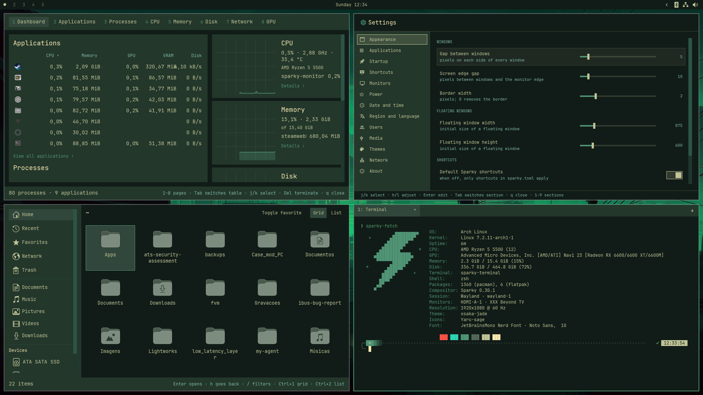
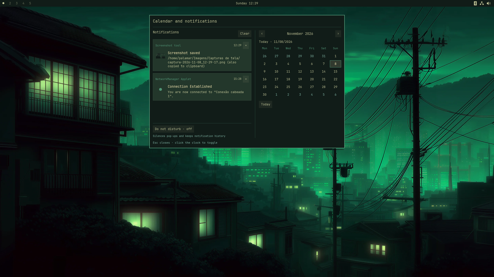
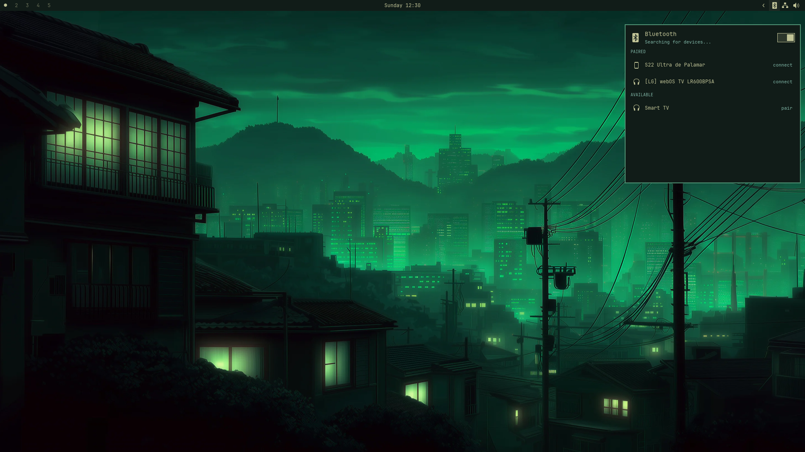
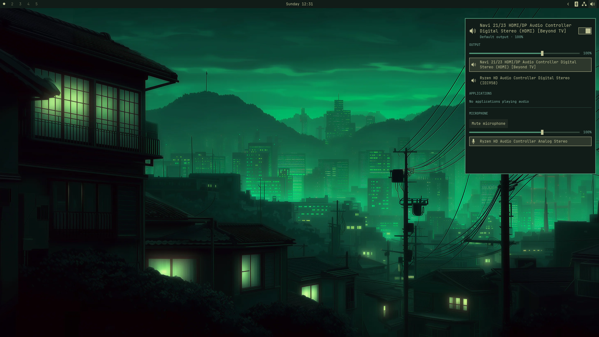

# Sparky

[English](README.md) | Português (Brasil)

Ambiente de desktop Wayland escrito em Rust, com compositor próprio, feito para ser usado pelo teclado. O mouse funciona, mas tudo tem atalho.

Somente os temas vem do [Omarchy](https://github.com/basecamp/omarchy): como paletas de cores e os wallpapers.

## Capturas de tela










## Organização

| Caminho | O que é |
|---|---|
| `crates/sparky-notifications` | Serviço nativo freedesktop de notificações, pop-ups temáticos, histórico da sessão e Não perturbe |
| `crates/sparky-bar` | A barra do topo (`sparky-bar`): áreas de trabalho, relógio e bandeja, uma por monitor |
| `crates/sparky-compositor` | O compositor Wayland (binário `sparky`), feito com a biblioteca Smithay: protocolos, janelas, bordas, teclado e ponteiro |
| `crates/sparky-tiling` | O mosaico: árvore dwindle, folgas, foco por direção, flutuantes, tela cheia, áreas de trabalho e monitores. Não depende de Wayland |
| `crates/sparky-config` | O `sparky.toml`: esquema, padrões do sparky, ações e a tabela de atalhos padrão |
| `crates/sparky-ipc` | Protocolo do IPC do sparky (JSON por linha num socket Unix), o cliente usado pela barra e pelos aplicativos, e o `sparky-msg` |
| `crates/sparky-fetch` | Informações do sistema e da sessão no terminal (`sparky-fetch`): Linux lido direto do sistema e Sparky pelo IPC, em saída visual, JSON ou texto simples |
| `crates/sparky-hardware` | Leitura de processador, memória e placas de vídeo, usada pelo sparky-settings e pelo sparky-fetch |
| `crates/sparky-shot` | O capturador de tela (`sparky-shot`): seletor de modo, seleção de região pelo teclado ou mouse, PNG salvo e copiado |
| `crates/sparky-files` | O gerenciador de arquivos (`sparky-files`): grade e lista com ícones e miniaturas, menus de contexto, dispositivos, lugares, filtro, copiar, recortar, colar, renomear, criar, compactar e lixeira |
| `crates/sparky-store` | Loja de aplicativos (`sparky-store`): Flathub primeiro, com fallback para os repositórios nativos de distribuições com pacman, APT e DNF |
| `crates/sparky-image` | O visualizador de imagens (`sparky-image`): abre PNG, JPEG, WebP, GIF, BMP e TIFF, navega pela pasta, zoom, deslocamento e rotação pelo teclado |
| `crates/sparky-monitor` | O monitor do sistema (`sparky-monitor`): aplicativos e processos com CPU, memória, GPU, VRAM e disco, gráficos de CPU, memória, disco, rede e GPU, e encerramento de processos pelo teclado |
| `crates/sparky-storage` | Volumes de bloco pelo udisksctl e smartphones MTP pelo udev/GIO/GVfs; parser de discos compartilhado com o painel |
| `crates/sparky-xdg` | Convenções XDG compartilhadas: pastas do usuário, leitura e listagem dos `.desktop` instalados, busca de programas e resolução de ícones dos temas |
| `crates/sparky-settings` | O painel de configurações (`sparky-settings`): edita o `sparky.toml` e aplica na hora pelo IPC |
| `crates/sparky-ui` | Peças comuns dos aplicativos iced: teclas, prompt, estilos, lateral numerada, rolagem e janela |
| `crates/sparky-launcher` | O lançador de aplicativos (`sparky-launcher`): busca nos `.desktop` instalados e abre pelo teclado |
| `crates/sparky-terminal` | O terminal padrão (`sparky-terminal`): abre o shell do usuário com as cores, a fonte e o layout do tema do sparky |
| `crates/sparky-keyring` | O chaveiro (`sparky-keyring`): guarda as senhas dos aplicativos num cofre cifrado e atende a API Secret Service do D-Bus |
| `crates/sparky-keyring-prompt` | A janela que pede a senha do cofre (`sparky-keyring-prompt`) |
| `crates/sparky-login` | O gerenciador de login (`sparky-login`): serviço do sistema que autentica pelo PAM, registra a sessão no logind e abre a sessão do usuário |
| `crates/sparky-login-greeter` | A tela de login (`sparky-login-greeter`): relógio, usuário, senha, energia e escolha da sessão |
| `crates/sparky-login-core` | Protocolo entre a tela e o serviço de login, a lista das sessões Wayland instaladas e a escolha do papel de parede do login |
| `crates/sparky-login-look` | O visual comum à tela de login e à de bloqueio: relógio, campos, papel de parede desfocado, cores e ícones |
| `crates/sparky-pam` | A autenticação pelo PAM, com a libpam carregada em tempo de execução, usada pelo login e pelo bloqueio |
| `crates/sparky-lock` | A tela de bloqueio (`sparky-lock`): relógio, nome do usuário e senha, pelo protocolo ext-session-lock |
| `crates/sparky-lockd` | O guarda do bloqueio (`sparky-lockd`): atende os pedidos de bloqueio do logind e bloqueia antes de suspender |
| `crates/polkit-sparky` | Agente de autenticação do sistema, com janela nativa, temas e integração polkit/PAM |
| `crates/sparky-theme` | Paleta de cores compartilhada pelos aplicativos, lida do `colors.toml` do tema |
| `data/themes` | Temas no formato `colors.toml` |

## Mosaico

Cada janela nova divide a caixa da janela em foco: lado a lado se a caixa for mais larga que alta, empilhada se não, e a nova fica à direita ou embaixo. A divisão escolhida é preservada quando a caixa muda de tamanho e pode ser invertida à mão. Fechar uma janela devolve o espaço para a vizinha. Entre janelas a folga é de 5 px de cada lado, e de 10 px até a borda da tela (`Gaps::SPARKY`).

As áreas de trabalho vão de 1 a 10 e cada uma pertence a um monitor. Ir para uma área visível em outro monitor leva o foco até ele; uma área vazia que sai da tela deixa de existir.

O rascunho é uma área extra que aparece por cima da área atual, como a área especial do Hyprland: `SUPER + S` (ou `SUPER` + a tecla à esquerda do 1) mostra e esconde, e `SUPER + ALT + S` (ou com `SHIFT` na tecla à esquerda do 1) manda a janela em foco para ele. Com o rascunho aberto, as janelas novas abrem nele, o foco fica nele e as janelas de baixo não respondem ao mouse; trocar de área esconde o rascunho e ele abre no monitor em foco. As ações no `sparky.toml` são `toggle-scratchpad` e `move-to-scratchpad`.

Grupos juntam várias janelas num só quadro do mosaico, com uma barra de abas no topo mostrando o título de cada uma: `SUPER + G` agrupa a janela em foco (ou desfaz o grupo), `SUPER + ALT + G` tira a janela do grupo, `SUPER + ALT` + seta põe a janela no grupo vizinho, `SUPER + ALT + TAB` e `SUPER + CTRL` + seta andam pelas abas e `SUPER + ALT + 1` a `5` escolhem a aba. Uma janela aberta a partir de outra que está num grupo entra nele. As ações no `sparky.toml` são `toggle-group`, `leave-group`, `move-into-group` (com `direction`), `cycle-group` (com `step`) e `select-in-group` (com `index`, a partir de 1).

Com o mouse, como no Omarchy: `SUPER` + botão esquerdo arrasta uma janela flutuante, e numa janela do mosaico troca de lugar com a janela onde ela for solta; `SUPER` + botão direito redimensiona pelo canto mais perto do ponteiro (no mosaico, move a divisão). Uma janela não encolhe abaixo de 120 × 80. Os pedidos de mover e redimensionar feitos pelos próprios aplicativos (barra de título desenhada pelo cliente, Wayland ou X11) usam o mesmo caminho.

## Compositor

O `sparky` é o próprio compositor Wayland; não depende de nenhum outro. Fala xdg-shell (janelas), wlr-layer-shell (barra, lançador, notificações), decorações do lado do servidor, área de transferência (incluindo seleção primária e wlr-data-control), viewporter, cursor-shape (o aplicativo pede o cursor pelo nome: texto, mão, redimensionar), relative-pointer (movimento cru do mouse, para jogos e programas 3D) e pointer-constraints (o aplicativo pode travar o ponteiro no lugar ou prendê-lo dentro da janela) e ext-session-lock (tela de bloqueio).

Aplicativos X11 rodam pelo XWayland, que o sparky sobe sozinho e controla com o gerenciador de janelas X11 do Smithay: janelas X11 entram no mosaico como as Wayland, menus e dicas X11 (janelas sem gerência) ficam por cima de tudo, e a área de transferência e a seleção primária passam nos dois sentidos. Os programas abertos pelo sparky recebem `DISPLAY` e `WAYLAND_DISPLAY`.

`SUPER + CTRL + L` bloqueia a sessão com o locker de `[apps]` (o `sparky-lock` por padrão, descrito em [Tela de bloqueio](#tela-de-bloqueio); `swaylock`, `hyprlock` e outros que falem ext-session-lock também servem). Bloqueado, só a tela do locker aparece e recebe teclado e mouse, os atalhos param (menos `Ctrl+Alt+F1…F12`) e a captura de tela também só vê o locker. Se o locker morrer sem desbloquear, a sessão continua bloqueada com a tela vazia, e um locker aberto de novo retoma o bloqueio.

Toda janela comum entra no mosaico. Flutuam as que têm janela-mãe (diálogos), as de tamanho fixo e as do painel de configurações e do capturador. A borda da janela em foco usa a cor de destaque do tema, e o foco do teclado acompanha o ponteiro.

Rodado num terminal virtual (ou pelo gerenciador de login), o `sparky` assume a placa de vídeo pela sessão do sistema (libseat), liga cada monitor conectado lado a lado da esquerda para a direita, acompanha monitor ligado e desligado em tempo real, lê teclado, mouse e touchpad pelo libinput (toque para clicar ligado) e desenha o cursor do tema `XCURSOR_THEME`, com o formato que cada aplicativo pedir. `Ctrl+Alt+F1…F12` troca de terminal virtual.

Para testar dentro de outra sessão Wayland, o `sparky` abre numa janela:

```bash
cargo run -p sparky-compositor -- --spawn kitty
```

`--spawn` pode se repetir e abre cada comando já dentro do sparky. O layout do teclado vem do `/etc/vconsole.conf` ou, no Debian, do `/etc/default/keyboard`.

## Configuração

Tudo fica em `~/.config/sparky/sparky.toml`; sem o arquivo valem os padrões do sparky, que estão por extenso em `data/config/sparky.toml`. O sparky confere o arquivo a cada segundo e aplica a mudança sem reiniciar (`sparky-msg reload` força na hora); um arquivo inválido é recusado e a configuração anterior continua valendo.

```toml
autostart = ["nm-applet"]

[general]
gaps_inner = 5
gaps_outer = 10
border = 2
default_binds = true

[input]
layout = "br"
variant = "abnt2"
repeat_rate = 40
repeat_delay = 250

[apps]
terminal = "kitty"

[[bind]]
keys = "SUPER + B"
action = "spawn"
command = "firefox"

[[bind]]
keys = "SUPER + H"
action = "focus"
direction = "left"

[[output]]
name = "DP-1"
scale = 1.5
```

Um `[[bind]]` com a mesma combinação de um atalho padrão substitui o padrão; `default_binds = false` descarta todos os padrões. Ações: `spawn` (`command`), `close-window`, `toggle-floating`, `fullscreen` (`mode` = `monitor` ou `maximized`), `toggle-split`, `focus` e `swap` (`direction` = `left`, `right`, `up`, `down`), `resize` (`width`, `height`), `workspace` (`workspace`), `move-to-workspace` (`workspace`, `follow`), `relative-workspace` (`step`), `previous-workspace`, `cycle-monitor` (`step`), `exit`. Cada `[[output]]` configura um monitor pelo nome (`sparky-msg outputs` lista os nomes): `scale` de 0.5 a 4, inclusive fracionada como 1.25 ou 1.5 (sem regra vale 1); `mode` com resolução e taxa, como `"1920x1080@60.000"` (sem ela, ou se o monitor não tiver esse modo, vale o modo preferido); `rotation` em graus (0, 90, 180 ou 270); `vrr = true` liga a taxa variável nos monitores que a suportam; `enabled = false` desliga a tela, mas a última tela ligada nunca é desligada; `hdr = true` envia HDR10 (cores BT.2020, curva PQ, metadados estáticos e 10 bits por cor) aos monitores cujo EDID anuncia PQ e BT.2020 e cujo conector expõe `Colorspace`, `max bpc` e `HDR_OUTPUT_METADATA`, desde que a placa de vídeo consiga compor em FP16. Com o HDR ligado, cada quadro desse monitor é convertido para PQ: as cores sRGB passam para BT.2020 sem exagerar a saturação e o branco do SDR fica em 203 nits, o valor de referência da ITU-R BT.2408. Nessas telas não há scanout direto nem cursor por plano de hardware, e as capturas de tela continuam em SDR. Os aplicativos descrevem a cor do próprio conteúdo pelo protocolo `wp-color-management-v1` (curvas sRGB, chamada `compound_power_2_4` na versão 2 do protocolo, gama 2.2, linear estendida e PQ; primárias sRGB, BT.2020, Display P3 e DCI-P3; scRGB do Windows), e o compositor converte cada janela para a tela: em HDR, o conteúdo HDR aparece com o brilho declarado até o pico da tela informado pelo EDID (1000 nits sem esse dado); em SDR e nas capturas, o que passa do branco é cortado, sem mapeamento de tons. Ao abrir a sessão, a tela liga em SDR e passa para HDR assim que exibe o primeiro quadro; se um quadro em HDR falhar ou a tela o recusar, o sparky a volta para SDR sem mudar o `sparky.toml`, registra o motivo no log do compositor e tenta de novo a cada recarga da configuração, como ao ligar o HDR na seção Monitores. A seção Monitores do sparky-settings grava essas opções e só mostra o HDR nas telas que o suportam. Os aplicativos recebem a escala pelo fractional-scale-v1 e desenham nítidos nela, e ao mudar a escala os monitores se reposicionam lado a lado. Sem `layout` em `[input]`, vale o teclado do sistema. Sem `terminal` em `[apps]`, vale `$TERMINAL` ou o primeiro terminal instalado, começando pelo `sparky-terminal`. `wallpaper` em `[general]` é o caminho da imagem de fundo (`~/` vale a pasta pessoal); `wallpaper = ""` deixa só a cor do tema, e sem a chave vale o primeiro papel de parede do Tokyo Night, se o pacote `sparky-wallpapers` estiver instalado. `wallpaper` em `[login]` é o papel de parede da tela de login; sem a chave, vale o da área de trabalho.

## Sessão

O gerenciador de login (SDDM, GDM…) lista a sessão **Sparky** pelo `data/session/sparky.desktop`, instalado em `/usr/share/wayland-sessions`, que abre o `sparky` com `XDG_CURRENT_DESKTOP=sparky`. Ao subir direto no hardware, o sparky:

- exporta `WAYLAND_DISPLAY`, `DISPLAY`, `XDG_CURRENT_DESKTOP`, `XDG_SESSION_TYPE` e `SPARKY_SOCKET` para o D-Bus e o systemd (`dbus-update-activation-environment --systemd`), para os portais e os serviços ativados acharem a sessão;
- reinicia o `sparky-session.target` do usuário, que prende o `graphical-session.target`: os portais (`xdg-desktop-portal`, `-wlr`, `-gtk`) e os serviços da sessão gráfica que sobraram de uma sessão anterior param e voltam presos ao compositor atual, mesmo com o `systemd --user` vivo entre um login e outro (linger);
- abre o chaveiro (`sparky-keyring`), o agente de autenticação (`polkit-sparky`), o guarda do bloqueio (`sparky-lockd`), as notificações nativas (`sparky-notifications`) e a barra (`sparky-bar`);
- abre o autostart XDG (`~/.config/autostart` e `/etc/xdg/autostart`), respeitando `Hidden`, `OnlyShowIn`, `NotShowIn`, `TryExec` e `X-GNOME-Autostart-enabled`; um arquivo do usuário substitui o do sistema com o mesmo nome.

Aninhado em outra sessão, nada disso acontece. Os portais usam `data/portals/sparky-portals.conf` (GTK, wlr para a tela e `sparky-keyring` para senhas), instalado em `/usr/share/xdg-desktop-portal`.

O `polkit-sparky` apresenta pedidos de autorização do sistema, como montar partições internas. A janela é própria do Sparky: usa a paleta ativa, a fonte e os cantos retos dos aplicativos nativos, com campo de senha, seleção dos usuários permitidos pelo sistema, Enter para confirmar, Tab para mudar o controle e Esc para cancelar. A paleta acompanha as mudanças de tema enquanto a janela está aberta.

A autenticação usa o polkit e o PAM do sistema por meio da biblioteca `libpolkit-agent-1`; os pacotes não dependem de outro agente gráfico. A senha solicitada é a da conta indicada pelo polkit e é independente da senha do cofre `sparky-keyring`. O agente não guarda essa senha. Cookies de autenticação são enviados ao processo da janela por um pipe privado, sem argumentos de linha de comando. Pedidos são serializados e cancelados quando a autoridade solicita ou a sessão termina. O registro é limitado à sessão logind atual. A inicialização automática ocorre no próximo login no Sparky.

## Barra

Uma barra de 26 px no topo de cada monitor, como a do Omarchy: as áreas de trabalho à esquerda (de 1 a 5 sempre, as outras até a 10 quando existem; a ativa vira um ponto, as vazias ficam apagadas, a 10 aparece como 0), o relógio no centro e a bandeja à direita. Clicar numa área vai para ela; o botão direito no relógio alterna entre `quarta 09:05` e `quarta, 07 de outubro de 2026`. A barra fala com o sparky pelo IPC e se atualiza a cada mudança.

A bandeja usa StatusNotifierItem pelo D-Bus. O clique esquerdo ativa o aplicativo ou abre o menu quando o item anuncia apenas um menu; o direito abre o menu. Escolher uma entrada habilitada ou pressionar Esc fecha o menu. A superfície também fecha quando o item desaparece ou o menu fica vazio.

Os ícones simbólicos do tema de ícones ativo (Yaru nos temas distribuídos) acompanham a cor da barra. A busca respeita a herança do tema e prioriza as variantes simbólicas de rede, preservando os estados de conexão; ícones próprios e pixmaps continuam disponíveis como fallback. Rede, Bluetooth e itens que pedem atenção permanecem visíveis. Os demais aplicativos ficam numa área recolhível: passar o mouse na seta abre os ícones para a esquerda, com transição de 600 ms e desaceleração cúbica; sair recolhe, mantendo a área aberta enquanto seu menu está visível. Cada monitor tem seu próprio estado, e o temporizador da animação para ao terminar a transição. Itens passivos não aparecem.

Os ícones de som, rede e Bluetooth abrem painéis nativos com o clique esquerdo; clicar novamente ou usar Esc fecha. O painel continua aberto quando outra superfície pega o teclado, como a seleção do `sparky-shot`, e por isso aparece na captura. Um painel aparece por vez, no monitor da interação, com fundo opaco, cantos retos e a paleta atual do Sparky. O restante da bandeja preserva os menus dos aplicativos e a gaveta animada. A barra fornece indicadores próprios de áudio e rede, evitando duplicá-los com applets; o indicador Bluetooth só aparece quando há adaptador.

O ícone de robô na bandeja abre o painel Agentes. Ele lista Claude Code, Codex e modelos Ollama instalados, inclusive CLIs em `~/.local/bin`; mostra os tokens observados hoje nos registros locais de sessões do Claude e do Codex; e exibe os limites das contas quando os serviços autenticados respondem. O botão de mais lista os agentes instalados para abrir no `sparky-terminal`. Um modelo Ollama em execução pode ser parado pelo cartão. Os dados são atualizados ao abrir o painel e enquanto ele permanece aberto, sem depender do Omarchy nem copiar os dados das contas dele. Limites indisponíveis não são estimados.

O painel de som controla volume, mudo, saída padrão, microfone e o volume individual dos aplicativos em reprodução pelo protocolo PulseAudio, compatível com PipeWire-Pulse. O cliente não abre fluxos de gravação ou reprodução. É necessário um servidor compatível em execução; o pacote exige a biblioteca cliente libpulse e recomenda PipeWire-Pulse. As mudanças de estado chegam por eventos e não por subprocessos de controle.

O painel de rede usa a API D-Bus do NetworkManager para mostrar interfaces, IPv4/gateway, conectividade e redes Wi-Fi; permite ligar/desligar o Wi-Fi, buscar redes, conectar/desconectar e escolher conexões salvas. Enquanto o painel está aberto, lê os contadores de tráfego da interface e mede ping e perda de pacotes por ICMP no gateway IPv4. O ping usa socket ICMP de datagrama, sem privilégios, permitido pelo `net.ipv4.ping_group_range` padrão do systemd; sem essa permissão ou sem gateway, o painel mostra "indisponível", e um pedido sem resposta aparece como "sem resposta". Novas redes abertas, WPA2-Personal e WPA3-Personal podem ser conectadas no próprio painel, com campo de senha e opção de lembrar. Perfis lembrados ficam no armazenamento protegido do NetworkManager; perfis temporários usam persistência volatile. Um agente de segredos limitado à conexão solicitada atende os pedidos de senha dessa operação. Redes corporativas e outros modos de segurança precisam de um perfil previamente configurado; o painel não configura VPN ou certificados. O botão Configurações de rede abre a seção Rede do sparky-settings, onde é possível selecionar uma conexão ativa e escolher entre DHCP e IPv4 manual. Em DHCP, a seção mostra o endereço IP, o gateway e o DNS recebidos do roteador, e os DNS primário e secundário informados podem ser usados junto com os do DHCP ou no lugar deles; a escolha atual do perfil é preservada. No modo manual, endereço IPv4/prefixo, gateway e DNS primário e secundário são editáveis, já preenchidos com o que o roteador entregou, e validados antes de salvar. Perfis com outros métodos IPv4, como compartilhado ou desativado, não aparecem para edição. Essa edição usa nmcli do NetworkManager, preserva as propriedades IPv6 e os endereços fixos extras de um perfil que continua em DHCP (sair do modo manual remove o endereço e o gateway manuais) e solicita a reaplicação da conexão; se a reaplicação não for possível, a configuração salva exige reconexão. Operações que exigem privilégios continuam usando polkit-sparky, com liberação temporária do teclado do painel para a autenticação.

O painel Bluetooth usa BlueZ para ligar/desligar adaptadores, listar dispositivos, conectar/desconectar e parear novos aparelhos. A busca dura até 15 segundos e encerra somente a sessão de descoberta iniciada pela barra. O agente nativo de pareamento atende confirmação de código, PIN, passkey e autorização para operações iniciadas no painel; não assume o papel de agente padrão global para pedidos externos. Ao concluir um pareamento aprovado, marca o dispositivo como confiável e solicita a conexão. Fechar o painel cancela as perguntas pendentes e a descoberta do próprio cliente. Ausência de hardware, serviço indisponível e falhas de operação aparecem no painel. NetworkManager e BlueZ são serviços opcionais recomendados; sem eles, as funções correspondentes ficam indisponíveis.

## IPC

O sparky abre um socket em `$XDG_RUNTIME_DIR/sparky-<WAYLAND_DISPLAY>.sock` e exporta o caminho em `SPARKY_SOCKET` para os programas que abre. Cada pedido e cada resposta é uma linha de JSON.

```bash
sparky-msg workspaces          # lista as áreas de trabalho
sparky-msg focus-workspace 3   # vai para a área 3
sparky-msg subscribe           # avisa a cada mudança nas áreas e no bloqueio
sparky-msg reload              # relê o sparky.toml
sparky-msg outputs             # lista os monitores e qual está em foco
sparky-msg info                # versão do compositor, sessão, tema e cores em uso
sparky-msg capture output tela.png                 # o monitor em foco
sparky-msg capture window janela.png               # a janela em foco, sem a borda
sparky-msg capture region 0 0 800 600 regiao.png   # região relativa ao monitor em foco
sparky-msg session lock        # o mesmo que as opções do menu do sistema:
sparky-msg session suspend     #   lock, suspend, logout, reboot e poweroff
sparky-msg session unlock      # pede ao locker que desbloqueie (SIGUSR1)
```

## Captura de tela

O próprio sparky desenha a área pedida numa textura fora da tela (as mesmas janelas e camadas da tela, sem o cursor) e grava o PNG. O pedido chega pelo IPC (`capture`), com o monitor inteiro, a janela em foco ou uma região relativa a um monitor; uma região que sai da tela é cortada na borda.

Programas de terceiros capturam monitor ou janela individual pelos protocolos `ext-image-copy-capture-v1` e `ext-image-capture-source-v1`, com lista de janelas por `ext-foreign-toplevel-list-v1`. O compositor desenha diretamente em DMA-BUF na GPU, e o `xdg-desktop-portal-wlr` leva a imagem ao OBS e aos navegadores pelo PipeWire. O seletor nativo respeita o tema do Sparky. Os pacotes incluem os portais e o PipeWire como dependências. Captura de janela exige o backend wlr 0.8.0 ou posterior; recomenda-se 0.8.4 ou posterior. O protocolo `wlr-screencopy-unstable-v1` continua compatível com `grim` e backends antigos, com SHM para screenshots e DMA-BUF para vídeo. Veja [configuração, arquitetura e validação de desempenho](docs/SCREENCAST.md).

O `sparky-shot` é o capturador que usa esse pedido:

| Atalho | Comando | O que faz |
|---|---|---|
| `PRINT` | `sparky-shot region` | Abre a seleção de região no monitor em foco |
| `SHIFT + PRINT` | `sparky-shot window` | Captura a janela em foco |
| `CTRL + PRINT` | `sparky-shot output` | Captura o monitor em foco |
| `SUPER + PRINT` | `sparky-shot` | Abre o seletor: `R` região, `J` janela, `M` monitor, `Tab` troca o atraso (nenhum, 3, 5 ou 10 s), `Esc` cancela |

Na seleção de região, as setas movem a área 10 px (1 px com `CTRL`), `SHIFT` com as setas redimensiona, `A` pega a tela toda, `Enter` captura e `Esc` cancela. Arrastar com o mouse desenha uma área nova. O atraso conta depois da seleção, para dar tempo de abrir um menu.

A imagem vai para `Capturas de tela` dentro da pasta de imagens (`XDG_PICTURES_DIR`, ou `~/Pictures`) com o nome `captura-AAAA-MM-DD_HH-MM-SS.png`, é copiada para a área de transferência pelo `wl-copy` e uma notificação avisa onde ficou (`notify-send`).

## Lançador

O `sparky-launcher` abre pelo `SUPER + ESPAÇO`: uma caixa no centro da tela com a busca já focada e a lista dos aplicativos instalados, com o nome no idioma do sistema. Digitar filtra (começo do nome primeiro, depois começo de palavra, trecho do nome, palavras-chave e descrição, e por fim as letras na ordem, como `ffx` para Firefox); setas, `Tab`/`SHIFT + Tab` ou `CTRL + N`/`P` (ou `J`/`K`) escolhem; `Enter` abre e `Esc` fecha. O clique também abre. A lista vem dos `.desktop` de `~/.local/share/applications` e das pastas de `XDG_DATA_DIRS` (Flatpak incluso), respeitando `NoDisplay`, `Hidden`, `OnlyShowIn`/`NotShowIn` e `TryExec`; aplicativos de terminal abrem no terminal escolhido, que o sparky passa aos programas em `TERMINAL`.

### Menu do sistema

`SUPER + ESC` abre o `sparky-launcher --system` (o `system_menu` de `[apps]`), com as mesmas teclas do lançador e cinco opções nesta ordem:

| Opção | O que faz |
|---|---|
| Bloquear | Abre o locker de `[apps]`, se a tela ainda não estiver bloqueada |
| Suspender | Bloqueia e suspende (`systemctl suspend`) assim que a tela trancar; se o locker não trancar em 5 segundos, suspende mesmo assim |
| Sair da sessão | Pede para todas as janelas fecharem e encerra o sparky quando a última fechar |
| Reiniciar | Fecha as janelas do mesmo jeito e roda `systemctl reboot` |
| Desligar | Fecha as janelas do mesmo jeito e roda `systemctl poweroff` |

Sair, Reiniciar e Desligar esperam os aplicativos fecharem sozinhos, como o hyprshutdown: nenhum é encerrado à força. Se depois de 8 segundos alguma janela continuar aberta (um aplicativo perguntando se quer salvar, por exemplo), o pedido é cancelado e uma notificação avisa quantas faltam; `SUPER + SHIFT + ESC` continua saindo na hora. Com o sparky aninhado em outra sessão, Suspender, Reiniciar e Desligar são recusados, para um teste nunca desligar a máquina; Bloquear e Sair funcionam.

## Terminal

O `sparky-terminal` é o terminal padrão: o sparky o procura antes dos outros terminais instalados, então ele abre no `SUPER + ENTER` e nos aplicativos de terminal do lançador. Ele abre o zsh com a configuração do próprio sparky (`ZDOTDIR=/usr/share/sparky/zsh`), sem ler o `~/.zshrc`, o oh-my-zsh ou o powerlevel10k do usuário; numa máquina nova ele já sai pronto. Para personalizar, copie a pasta para `~/.config/sparky/zsh/` (respeitando `XDG_CONFIG_HOME`): com um `.zshrc` lá, ela substitui a do sistema. Sem zsh instalado, abre o shell da conta. O shell recebe `TERM=xterm-256color`, `COLORTERM=truecolor` e `TERM_PROGRAM=sparky-terminal`. Com `fetch_on_start = true` em `[terminal]` no `sparky.toml` (desligado por padrão), cada aba que abre o shell mostra antes o `sparky-fetch` na largura da aba; abas com `-e comando` não mostram, e se o `sparky-fetch` faltar, falhar ou passar de 1,5 s, a aba abre normalmente sem ele.

A configuração (`data/zsh/`) reproduz a do powerlevel10k *rainbow* em zsh puro, nas cores do tema:

- prompt em duas linhas com moldura `╭─`/`╰─`, a pasta em azul, o git em verde (limpo) ou amarelo (com mudanças) com ramo, `⇣⇡`, `*` stash, `~` conflitos, `+` preparados, `!` alterados e `?` novos, o pontilhado até a direita, `✔` ou `✘ código`, o tempo do comando a partir de 3 segundos, tarefas em segundo plano e a hora; depois de executar, o prompt anterior encolhe para `❯`;
- histórico de 50 mil linhas em `~/.local/state/sparky/zsh_history`, completação com menu e sem diferenciar maiúsculas, setas buscando pelo começo da linha, `CTRL + ←/→` por palavra;
- aliases do git (`gst`, `gco`, `gcb`, `gaa`, `gcmsg`, `gp`, `gpsup`, `glog` e outros no padrão do oh-my-zsh), `copyfile`, `CTRL + O` copiando a linha (copybuffer), `ALT + ←/→/↑` voltando, avançando e subindo entre pastas (dirhistory), `google`, `ddg`, `github`, `youtube`, `wiki` e `stackoverflow` (web-search), e o autojump e o fzf quando instalados;
- `zsh-autosuggestions` e `zsh-syntax-highlighting` dos pacotes da distribuição, que o sparky instala junto.

A emulação (PTY, sequências VT/xterm, histórico de 10 mil linhas e seleção) vem da biblioteca `alacritty_terminal`; a janela, o desenho das células, o teclado e as cores são do sparky. O texto usa a JetBrainsMono Nerd Font em 12 px, com a margem de 18 px e os cantos retos do sparky, e mede a célula com o mesmo motor de texto que desenha, para as colunas não desalinharem. Negrito, itálico, sublinhado, riscado, inverso, esmaecido, 256 cores, truecolor, caracteres largos e os glifos da Nerd Font aparecem como no kitty.

As cores seguem o tema do sparky, inclusive com o terminal aberto: as 16 cores ANSI saem do `colors.toml` na mesma ordem que o Omarchy usa no kitty (`background`, `red`, `green`, `yellow`, `blue`, `magenta`, `cyan`, `foreground`, `muted` e as `bright_*`), o cursor e a seleção usam `bright_foreground` e `selection`, e aplicar outro tema no painel recolore o terminal em até um segundo. Cores trocadas por um programa (OSC 4, 10, 11 e 12) valem até o programa desfazer.

| Tecla | O que faz |
|---|---|
| `CTRL + SHIFT + C` ou `CTRL + INSERT` | Copia a seleção |
| `CTRL + SHIFT + V` ou `SHIFT + INSERT` | Cola, entre as marcas de bracketed paste quando o programa pede, sem deixar o texto colado fechar o bloco |
| `SHIFT + PGUP` / `SHIFT + PGDN` | Rola o histórico uma página |
| `SHIFT + HOME` / `SHIFT + END` | Vai para o começo ou o fim do histórico |
| `CTRL + SHIFT + T` | Cria uma aba com um novo shell |
| `CTRL + SHIFT + Q` | Fecha a aba atual |
| `CTRL + SHIFT + ←/→` | Alterna entre abas, voltando pelas extremidades |
| Clique no botão do meio | Cola a seleção primária |
| `SHIFT + ENTER` / `ALT + SHIFT + ENTER` | Envia `\e[13;2u` / `\e[13;4u`, como no kitty |

O mouse seleciona arrastando com o botão esquerdo; soltar publica o texto na seleção primária, separada da área de transferência de `CTRL + SHIFT + C/V`. Clicar na rodinha cola essa seleção, inclusive quando vem de outro aplicativo. A roda rola o histórico. Quando o programa solicita eventos de mouse, recebe a roda com as coordenadas da célula no formato pedido (SGR, UTF-8 ou legado), nos buffers principal e alternativo. Sem essa solicitação, a roda em tela alternativa (`less`, `man`) continua virando setas. Movimentos fracionários são acumulados até completar uma linha. Digitar volta ao fim do histórico e limpa a seleção. O título da janela vem do shell da aba ativa. Cada aba mantém seu PTY, histórico, seleção e rolagem, e os programas continuam funcionando nas abas inativas. O fim de um shell fecha somente sua aba; fechar a última encerra a janela. Uma colagem assíncrona permanece vinculada à aba que a pediu e é descartada se ela já tiver sido fechada.

```bash
sparky-terminal                       # o shell do usuário
sparky-terminal -d ~/Projetos         # começando nessa pasta
sparky-terminal -e htop               # roda um comando; o resto da linha são os argumentos dele
```

A barra de abas usa a fonte, as cores e os cantos retos do Sparky e acompanha o tema ao vivo. Clique no título para alternar, em `×` para fechar ou em `+` para criar. Muitas abas podem ser percorridas pela rolagem horizontal; a aba escolhida pelo teclado é trazida para a área visível. A primeira aba respeita `-e` e `-d`; as seguintes abrem o shell do Sparky na pasta inicial escolhida por `-d`, quando informada. Os atalhos de abas são tratados pelo terminal antes do envio ao PTY; `CTRL + C` continua interrompendo comandos. Divisões de janelas continuam com o mosaico e os grupos do Sparky. O envio de mouse aos programas cobre somente a roda vertical; cliques e arrastos continuam dedicados à seleção e colagem do terminal. O protocolo de teclado do kitty ainda não está implementado.

## sparky-fetch

O `sparky-fetch` mostra no terminal as informações do sistema e da sessão, com o logotipo do Sparky ao lado. Do Linux, ele lê direto do sistema: sistema, kernel, tempo ligado, CPU, GPU, memória, disco, terminal, shell e pacotes (pacman, dpkg, rpm e flatpak). Do Sparky, consulta o compositor pelo IPC: versão, sessão Wayland, monitores, resolução, tema e cores do tema. Ícones e fonte vêm das configurações do GTK que o sparky-settings grava. Fora de uma sessão do Sparky, ou com o compositor sem resposta, as informações do Linux continuam aparecendo.

```bash
sparky-fetch                                # no terminal: visual e colorido; num pipe: texto simples
sparky-fetch --json                         # todos os campos, com o estado de cada um
sparky-fetch --fields os,kernel,memory      # escolhe os campos e a ordem (--list-fields lista todos)
sparky-fetch --hide gpu,packages --no-logo
sparky-fetch --layout stacked --width 60 --accent '#ff9e64'
```

A configuração fica em `~/.config/sparky-fetch/config.toml` (respeitando `XDG_CONFIG_HOME`); o que vem pela linha de comando vale sobre o arquivo, e o arquivo vale sobre os padrões. `--config` usa outro arquivo e `--no-config` não lê nenhum.

```toml
fields = ["os", "kernel", "cpu", "memory", "compositor", "theme", "colors"]
hide = ["gpu"]
format = "visual"      # visual, json ou plain
color = "auto"         # auto, always ou never (NO_COLOR também desliga)
logo = true
layout = "classic"     # classic (logotipo ao lado) ou stacked (logotipo acima)
width = 90
timeout_ms = 400

[colors]
accent = "#7aa2f7"     # logotipo e rótulos; sem ele, vale o destaque do tema
label = "#7aa2f7"
value = "#c0caf5"
```

No modo visual, o logotipo passa para cima quando a largura não comporta os dois lado a lado e some quando nem ele cabe; valores longos são cortados com `…`. No JSON, cada campo traz `status`: `ready` (com `value`), `unavailable` (com `reason`: `missing`, `no_compositor`, `unsupported` ou `uncollected`), `timed_out` ou `failed` (com `error`); na saída visual e no texto simples, tudo que não ficou pronto aparece como `N/A`. A coleta roda em paralelo, com até quatro coletores ao mesmo tempo e um prazo total (`timeout_ms`, 400 ms por padrão); o que não responde a tempo vira `timed_out` sem segurar o resto. Um compositor anterior ao pedido `info` do IPC responde só monitores e resolução, e os outros campos do Sparky ficam como `unsupported`. Para o `sparky-terminal` abrir cada aba com o `sparky-fetch`, use `fetch_on_start = true` em `[terminal]` no `sparky.toml` (veja [Terminal](#terminal)).

## Chaveiro

O `sparky-keyring` guarda as senhas e tokens que os aplicativos pedem para lembrar (navegadores, VS Code, git com `libsecret`, clientes de e-mail). Ele atende o nome `org.freedesktop.secrets` no D-Bus da sessão com a API Secret Service, a mesma do gnome-keyring, então os aplicativos funcionam sem configuração. Para os aplicativos Flatpak, atende também o portal de segredos (`data/portals/sparky-keyring.portal`).

- O cofre fica em `~/.local/share/sparky/keyrings/login.json` (respeitando `XDG_DATA_HOME`), com a pasta só para o dono (700) e o arquivo também (600). Cada gravação substitui o arquivo de uma vez, sem deixar o cofre pela metade.
- O conteúdo é cifrado com XChaCha20-Poly1305 por uma chave derivada da senha pelo Argon2id (64 MiB, 3 passagens). Rótulos, atributos e segredos só existem cifrados; para a busca funcionar com o cofre trancado, o arquivo guarda um resumo SHA-256 de cada atributo, protegido contra alteração junto com o conteúdo.
- A senha do cofre é própria, separada da senha de login. Na primeira vez que um aplicativo quer guardar algo, o `sparky-keyring-prompt` pede para criar a senha (duas vezes, para conferir); depois, na primeira vez em cada sessão que um aplicativo precisa de uma senha guardada, pede para destrancar. Senha errada pede de novo; `Esc` cancela e o aplicativo recebe a recusa.
- O cofre fica destrancado até a sessão acabar: quando o compositor fecha, o `sparky-keyring` encerra e a chave some da memória.
- Há um cofre só, o padrão (`default`/`login`). O transporte das senhas pelo D-Bus usa o algoritmo `plain` da especificação; aplicativos que pedem o algoritmo cifrado recebem a recusa e repetem com `plain`, como manda a especificação.

Se outro chaveiro (gnome-keyring, KWallet) já tiver o nome `org.freedesktop.secrets` quando a sessão subir, o `sparky-keyring` avisa no log e não sobe; as senhas continuam com o outro chaveiro. As senhas que já estavam no gnome-keyring não são copiadas: cada aplicativo pede login uma vez dentro do sparky.

## Tela de login

O `sparky-login-greeter` é a tela de login própria do sparky, feita para substituir o SDDM, o GDM e afins. À esquerda, em 40% da largura, ficam o relógio em 12 horas (`06:19 PM`), a data (`Monday 2 November`), o usuário, a senha, o botão **Login**, os botões **Desligar**, **Reiniciar** e **Suspend** e a sessão (`Session (Sparky)`); essa faixa recebe um desfoque leve do papel de parede, que cobre a tela sem distorcer. Os tamanhos seguem a altura da tela (em 1080 linhas, o relógio tem 156 px e os campos 39 px) e as cores vêm do tema do sparky.

- O nome de usuário fica em minúsculas; com o último usuário já preenchido, o foco começa na senha.
- `Tab` e `SHIFT + Tab` passam por usuário, senha, Login, energia e sessão; `Enter` confirma o que está em foco, e na sessão passa para a próxima.
- O olho no campo da senha mostra e esconde o que foi digitado.
- As sessões vêm dos `.desktop` de `wayland-sessions` em `$XDG_DATA_DIRS` (sem a variável, `/usr/local/share` e `/usr/share`), sem as ocultas e as que não estão instaladas; a primeira pasta vence quando o arquivo se repete, e sem preferência vale o Sparky.
- Senha errada apaga a senha e mostra `Falha no login!` acima do usuário.

A sessão escolhida fica guardada junto com o usuário: no próximo login, os dois já vêm escolhidos.

### Serviço de login

O `sparky-login` é o serviço do sistema que substitui o SDDM e o GDM. Ele roda como root pelo `sparky-login.service`, ocupa o terminal 1 e, a cada tela de login, abre o compositor em modo restrito (`sparky --login-screen sparky-login-greeter`) como o usuário de sistema `sparky-login`, numa sessão do logind de classe `greeter`. Nesse modo o compositor não tem atalhos, autostart, IPC nem XWayland; só a troca de terminal (`CTRL + ALT + F1` a `F12`) continua valendo, e ele fecha quando a tela fecha.

- A tela fala com o serviço por `/run/sparky-login/greeter.sock`, que só o usuário `sparky-login` acessa (0600, conferido pela credencial do processo do outro lado).
- Cada tentativa de login roda num processo próprio (`sparky-login --worker`), que autentica pelo serviço PAM `sparky-login` (`pam_authenticate` e `pam_acct_mgmt`). Senha errada, usuário desconhecido e tentativas demais dão a mesma recusa; senha ou conta expirada explicam o motivo.
- Com a senha certa, o serviço guarda o usuário e a sessão em `/var/lib/sparky-login/memory.json`, espera a tela fechar e abre a sessão: `XDG_SESSION_TYPE=wayland`, `XDG_SESSION_CLASS=user`, `XDG_SEAT=seat0`, `XDG_VTNR`, `XDG_SESSION_DESKTOP` (o nome do `.desktop`) e `XDG_CURRENT_DESKTOP` (o `DesktopNames` dele) para o `pam_systemd`, credenciais e sessão do PAM, e o `Exec` da sessão pelo shell de login do usuário (`$SHELL -l -c`), já com os grupos, o gid e o uid dele e o terminal como terminal de controle.
- Quando a sessão acaba, o serviço fecha a sessão do PAM e abre a tela de novo. Se a tela cair, ela volta sozinha; se não fechar depois do login, recebe `SIGTERM` depois de 10 s.
- Desligar, Reiniciar e Suspend pedem ao logind (`PowerOff`, `Reboot`, `Suspend`).
- O PAM próprio não liga o gnome-keyring: dentro do sparky, as senhas ficam com o `sparky-keyring`.
- A tela usa as cores e o papel de parede de quem entrou por último. No começo e no fim de cada sessão, o serviço lê, com as permissões do próprio usuário, o `colors.toml` do tema e a imagem escolhida para a tela de login (sem escolha, a da área de trabalho) e guarda uma cópia em `/var/lib/sparky-login/appearance`, que só o root e a tela leem. A imagem precisa ser um arquivo comum de até 32 MiB. Sem a cópia, valem o tema e o papel de parede padrão.

Os pacotes instalam o serviço, o usuário (`sysusers.d`), a pasta da tela (`tmpfiles.d`) e os dois arquivos do PAM (`/etc/pam.d/sparky-login`, do jeito de cada distribuição, e `/etc/pam.d/sparky-login-greeter`), mas não habilitam o serviço. Para trocar o SDDM pelo sparky-login:

```sh
sudo systemctl disable sddm
sudo systemctl enable sparky-login
sudo reboot
```

Para voltar, entre num terminal com `CTRL + ALT + F2`, faça login e rode `sudo systemctl disable sparky-login && sudo systemctl enable sddm && sudo reboot`. O log do serviço fica no journal: `journalctl -u sparky-login -b`.

A prévia abre em qualquer sessão Wayland com layer-shell: `sparky-login-greeter --preview [--wallpaper <imagem>]`. Sem `--wallpaper`, vale o primeiro papel de parede do tema padrão. Na prévia nenhuma senha entra, os botões de energia não fazem nada e `Esc` fecha; na tela de verdade, `Esc` não fecha nada.

## Tela de bloqueio

O `sparky-lock` é a tela de bloqueio padrão do sparky (`locker` em `[apps]`), aberta pelo `SUPER + CTRL + L` e pelo Bloquear do menu do sistema. Ela tem o mesmo visual da tela de login: relógio, data, a faixa desfocada à esquerda, o nome do usuário fixo e o campo de senha, sem seletor de sessão nem botões de energia. As cores vêm do tema do sparky e o papel de parede é o da tela de login (`[login] wallpaper`; sem ele, o da área de trabalho).

- A mesma tela aparece em cada monitor, e a senha digitada em qualquer um deles vale.
- `Enter` ou **Unlock** conferem a senha pelo serviço PAM `sparky-lock` (no Arch e no Fedora, `auth include login`; no Debian, `common-auth`). Senha errada apaga a senha e mostra `Senha incorreta!`; as mensagens do próprio PAM, como a de conta bloqueada por tentativas demais, aparecem no lugar do aviso.
- `Esc` apaga a senha digitada; o olho mostra e esconde a senha.
- O bloqueio usa o protocolo ext-session-lock: o compositor só mostra a tela de bloqueio, os atalhos param e as capturas de tela são recusadas. Se o `sparky-lock` cair, a sessão continua bloqueada; para destrancar, entre num terminal (`Ctrl+Alt+F2`) e rode `WAYLAND_DISPLAY=wayland-1 sparky-lock` (o número do `WAYLAND_DISPLAY` é o da sessão), depois volte com `Ctrl+Alt+F1`.

O `sparky-lockd` sobe com a sessão e liga o bloqueio ao logind:

- `loginctl lock-session` (e quem pede o bloqueio ao logind) abre o locker; `loginctl unlock-session` pede ao locker que desbloqueie, mandando `SIGUSR1` para ele (o `sparky-lock`, o `swaylock` e o `hyprlock` desbloqueiam com esse sinal).
- Antes de suspender, por qualquer caminho (menu, `systemctl suspend`, tampa do notebook), ele segura a suspensão com um inibidor de atraso do logind até a tela estar bloqueada; se o bloqueio não vier em 5 segundos, a suspensão segue assim mesmo.
- A dica `LockedHint` da sessão no logind acompanha o bloqueio, para outros programas saberem que a tela está bloqueada.
- O compositor avisa no IPC quando bloqueia e desbloqueia (`sparky-msg subscribe` mostra `locked` e `unlocked`) e aceita `sparky-msg session unlock`.

A sessão também bloqueia sozinha depois de um tempo sem teclado nem mouse: `idle_minutes` em `[lock]` (10 minutos por padrão; `0` desliga), também ajustável na seção Energia do sparky-settings (Nunca, 1, 2, 5, 10, 15 ou 30 minutos, ou 1 hora). Enquanto um programa pede para a tela não apagar, como um navegador ou player tocando vídeo, o tempo parado não bloqueia: vale o protocolo idle-inhibit e também o serviço `org.freedesktop.ScreenSaver` (`Inhibit`/`UnInhibit`) que o `sparky-lockd` oferece na sessão, usado pelo Firefox, pelo Chrome, pelo VLC e pelo portal `xdg-desktop-portal`; um pedido some sozinho quando o programa que o fez sai. O compositor também oferece o ext-idle-notify, para programas como o `swayidle` saberem quando a sessão está parada.

## Arquivos

O `sparky-files` abre pelo `SUPER + SHIFT + F` (ou `sparky-files <pasta>`). Abre em grade, com ícones e nomes de pastas e arquivos, e permite alternar para a lista com tamanho e data pelos botões Grade/Lista ou por `CTRL + 1`/`CTRL + 2`. A grade se adapta à largura da janela; as pastas vêm primeiro e os nomes seguem a ordem natural, sem distinguir maiúsculas nem acentos (`foto2` antes de `foto10`, `Élan` entre `alfa` e `Zeta`), e a visualização se atualiza assim que a pasta muda, inclusive quando um arquivo é regravado no lugar: eventos do inotify que chegam juntos viram uma única atualização em até 400 ms, e pastas sem inotify, como celulares e compartilhamentos de rede, são conferidas a cada 2 s. Trocar a visualização preserva filtro, seleção e itens marcados. Listar uma pasta lê só nomes e tipos; tamanho e data são consultados apenas para as linhas na tela, conforme aparecem, e uma pasta com 100 mil arquivos abre cerca de sete vezes mais rápido (por volta de 27 ms em vez de 187 ms no Btrfs com cache quente).

Os ícones seguem o tema configurado pelo painel no GTK, incluindo sua herança (`index.theme`). O gerenciador prefere os tamanhos do tema mais próximos de 96 px, inclusive as pastas em escala dupla (`48x48@2x`), para os ícones não ficarem borrados. Pastas especiais e tipos comuns de arquivo têm ícones próprios; sem um ícone instalado, o sparky desenha um ícone de reserva. Uma troca de tema atualiza os ícones sem fechar o gerenciador.

Imagens PNG, JPEG e WebP mostram uma miniatura do conteúdo no lugar do ícone. As miniaturas são geradas em segundo plano, duas por vez e só para os itens visíveis, a partir de arquivos de até 16 MiB e 8192 px de lado. Seguem o cache de miniaturas do freedesktop, compartilhado com outros gerenciadores de arquivos: uma miniatura já presente em `~/.cache/thumbnails` (`normal`, `large`, `x-large` ou `xx-large`) é reaproveitada quando o URI e a data de modificação conferem com o arquivo, e as novas são gravadas em `normal`, com permissão `0600`. As miniaturas são refeitas quando o arquivo muda. Arquivos maiores ou que não puderem ser lidos ficam com o ícone do tipo.

A lateral também permite abrir a **Lixeira**. Ela mostra os itens de `~/.local/share/Trash/files`, incluindo os enviados por outros aplicativos para esse local. Selecione um item e use **Restaurar item** no topo ou no menu de contexto para devolvê-lo ao caminho registrado em seu `.trashinfo`; **Restaurar todos** devolve todos os itens da lixeira, inclusive os ocultos pelo filtro. Depois de restaurar, um aviso flutuante diz para qual pasta os itens voltaram e oferece **Abrir pasta**, que vai até ela e seleciona o item. **Esvaziar lixeira** pede confirmação antes de excluir permanentemente todos os itens, inclusive os ocultos pelo filtro. Se o destino já existir ou o registro estiver ausente/inválido, o item permanece na lixeira e o erro é exibido. Dentro da lixeira, criar, renomear, recortar, colar e mover novamente para a lixeira ficam indisponíveis; restaure o item antes de abri-lo. Itens de outros discos (pendrives, outras partições) vão para a lixeira do próprio disco, como define a especificação freedesktop: `.Trash/<uid>` quando o disco tem uma pasta `.Trash` compartilhada com sticky bit, ou `.Trash-<uid>` nos demais casos, com o caminho original registrado em relação à raiz do disco, para a restauração funcionar mesmo que ele seja montado em outro lugar. Cada disco com itens na lixeira ganha sua própria linha **Lixeira · nome** abaixo de **Lixeira**, com as mesmas ações de restaurar e esvaziar; celulares e compartilhamentos de rede não têm lixeira, então ali `d` e `Delete` abrem a janela de confirmação para excluir permanentemente.

Na lateral ficam os lugares e os dispositivos: SSDs, partições e unidades removíveis com sistema de arquivos, montados ou não. A lista se atualiza a cada dois segundos. Um clique abre o volume montado; se estiver desmontado, pede a montagem pelo `udisksctl` e abre o ponto retornado. O botão de desmontar é separado e nunca força a operação. `ALT + 1` a `9` montam/abrem os dispositivos correspondentes; `ALT + U` pede a desmontagem do volume aberto. A montagem depende do `udisks2` e das permissões do sistema; recusas e dispositivos ocupados aparecem como aviso. As consultas usam `lsblk` (`util-linux`). Partições do sistema, swap e contêineres criptografados ainda trancados não são oferecidos para montagem/desmontagem. Ao retirar o volume em que está navegando, o gerenciador volta à pasta pessoal.

Smartphones Android em modo de transferência de arquivos também aparecem na lateral, com ícone de telefone e indicação MTP. A descoberta usa os registros USB do udev e não monta automaticamente. Clicar conecta pelo GIO/GVfs, reutilizando um acesso existente e abrindo seu caminho FUSE dentro do próprio sparky-files. As pastas sob a raiz FUSE do GVfs (celulares e compartilhamentos de rede) são listadas pelo GIO numa única passagem, que traz nome, tipo, tamanho e data, em vez de uma consulta FUSE por item. O botão de desmontar encerra esse acesso sem forçar. O telefone deve estar desbloqueado e autorizar a transferência de arquivos; dispositivos em modo de carregamento e iPhones não estão cobertos por esse suporte MTP.

O backend depende de `gvfs-mtp` no Arch e Fedora; no Debian/Ubuntu, de `gvfs-backends` e `gvfs-fuse`. No Fedora também é necessário `gvfs-fuse`; no Arch o acesso FUSE já faz parte de `gvfs`. Os pacotes declaram esses componentes como dependências opcionais/recomendadas, mantendo a política usada para o udisks2. Não é necessário executar outro gerenciador de arquivos. Falhas de acesso, backend ausente e telefone ocupado aparecem como aviso, e a espera das operações assíncronas de montagem/desmontagem é limitada a 30 segundos.

Quando o polkit exige autenticação, o agente gráfico da sessão pede a senha. O gerenciador continua respondendo enquanto aguarda e permite tentar novamente após cancelar. O `udisksctl` é executado sem o terminal de controle da sessão, pelo `setsid` do `util-linux`, para evitar pedidos de senha invisíveis no terminal. Os tooltips têm fundo opaco com as cores do tema.

As consultas periódicas de dispositivos não exibem indicador de atualização. A lateral mostra progresso apenas durante montagem e desmontagem, mantém os avisos de erro e preserva a mensagem de lista vazia durante as consultas.

| Tecla | Ação |
|---|---|
| `j` `k` ou `↑` `↓` | Desce e sobe uma linha da grade ou lista |
| `←` `→` | Na grade, escolhe o item vizinho; na lista, volta/abre |
| `Enter` ou `l` | Abre a pasta ou o arquivo (no aplicativo padrão, pelo `xdg-open`) |
| `h`, `Backspace` ou `ALT + ↑` | Volta para a pasta de cima, com a de origem selecionada |
| `g` / `G`, `Home` / `End`, `PageUp` / `PageDown` | Começo, fim e páginas |
| `1` a `9` | Vai para o lugar com esse número |
| `/` | Filtra pelo nome enquanto digita; `Enter` fixa, `Esc` limpa |
| `.` ou `CTRL + H` | Mostra ou esconde os ocultos |
| `Espaço` | Marca o item e avança; as ações valem para os marcados ou, sem marcas, para o selecionado |
| `y` / `x` / `p` (ou `CTRL + C` / `X` / `V`) | Copia, recorta e cola; colar na mesma pasta cria `nome (cópia).ext`, e um nome já ocupado no destino pergunta o que fazer |
| `r` ou `F2` | Renomeia, já com o nome sem a extensão selecionado; com dois ou mais marcados, renomeia em lote: `Viagem {n}` numera na ordem da lista mantendo as extensões (com zeros à esquerda quando há dez ou mais), e `antigo -> novo` troca um trecho em todos os nomes. A barra de status mostra a prévia dos novos nomes e recusa nomes repetidos ou já ocupados, sem mudar nada; `CTRL + Z` desfaz o lote inteiro |
| `a` | Cria: `nome/` vira pasta, sem a barra vira arquivo vazio |
| `d` ou `Delete` | Manda para a lixeira (`~/.local/share/Trash`, com o `.trashinfo`) sem perguntar; um aviso flutuante oferece **Desfazer** por alguns segundos |
| `SHIFT + Delete` | Exclui permanentemente, sem passar pela lixeira e sem `CTRL + Z`, depois de confirmar numa janela com **Cancelar** e **Excluir** (`Enter` confirma, `Esc` cancela) |
| `CTRL + T` / `CTRL + W` | Abre uma aba na pasta atual / fecha a aba atual (a última fica aberta). Com duas ou mais, a barra de abas aparece no topo: clicar troca de aba e `×` fecha. Cada aba guarda sua pasta, seleção, ordenação e busca, e é relida ao voltar para ela |
| `CTRL + Tab` / `CTRL + SHIFT + Tab` (ou `CTRL + PageDown` / `PageUp`) | Próxima / aba anterior |
| `CTRL + F` | Busca nas subpastas da pasta aberta: todas as palavras precisam aparecer no nome, sem diferenciar maiúsculas nem acentos. Os resultados chegam aos poucos, com o caminho relativo, e podem ser abertos, copiados, movidos ou mandados para a lixeira; ocultos só entram quando estão visíveis, links não são seguidos e a busca para nos primeiros 5000 itens. `Esc` volta à pasta |
| `e` | Extrai os compactados escolhidos (`.zip`, `.7z`, `.rar` e `.tar.*`) na mesma pasta, em segundo plano |
| `s` / `S` | Troca o critério de ordenação (nome, tamanho, data de modificação, tipo) / inverte a ordem; as pastas ficam sempre no topo, e na lista clicar no título de uma coluna ordena por ela (de novo, inverte) |
| `F5` ou `CTRL + R` | Relê a pasta |
| `CTRL + Z` | Desfaz a última renomeação, criação, ida para a lixeira, cópia ou movimentação (até 50 passos; cópias e itens criados vão para a lixeira) |
| `CTRL + D` | Adiciona a pasta aberta aos **Marcadores**; uma pasta já marcada não é repetida |
| `q` ou `CTRL + Q` | Fecha |

| `CTRL + SHIFT + N` | Cria uma pasta, com o nome sugerido selecionado |
| `CTRL + A` | Marca todos os itens visíveis |
| `ALT + Enter` | Mostra as propriedades do item selecionado ou, sem seleção, da pasta aberta |

Com o mouse, um clique seleciona, dois cliques abrem e a roda rola a lista. Pressionar sobre um item e arrastar leva o item (ou todos os marcados, se ele estiver marcado) até uma pasta da lista, um lugar da lateral, outra aba ou a **Lixeira**; o alvo fica destacado e a barra de status mostra as opções. No mesmo disco o item é movido e entre discos é copiado; segurar `CTRL` força a cópia e `SHIFT` força mover. Soltar usa a mesma transferência em segundo plano de colar (com progresso, pergunta de conflito e `CTRL + Z`), mas não mexe na área de transferência; soltar na Lixeira manda direto para ela, com o mesmo aviso de **Desfazer**, e `Esc` cancela o arraste. Soltar pastas na seção **Marcadores** da lateral adiciona cada uma como marcador, sem mover nada; arquivos e pastas já marcadas são ignorados. Os marcadores podem ser reordenados arrastando um sobre o outro, e um clique abre a pasta. Eles ficam em `~/.config/sparky/bookmarks` (ou `$XDG_CONFIG_HOME/sparky/bookmarks`), um arquivo próprio do Sparky, e persistem entre sessões sem depender de outro gerenciador de arquivos. Na sessão Sparky, arrastar além da borda da janela entrega os arquivos ao compositor, que os leva para outro aplicativo pelo IPC (`drag`) e oferece `text/uri-list` e `x-special/gnome-copied-files`, sempre como cópia. Soltar arquivos de outros aplicativos dentro do `sparky-files` ainda não é possível, porque o winit não implementa arrastar e soltar no Wayland.

O clique direito abre um menu de contexto nas cores do tema. Sobre um arquivo ou pasta, oferece abrir, abrir com outro aplicativo, recortar, copiar, mover para, copiar para, renomear, comprimir, e-mail, mover para a lixeira, excluir permanentemente e propriedades. Na área vazia, oferece nova pasta, novo documento, abrir a pasta com outro aplicativo, colar, selecionar tudo e propriedades. Se o item já estiver marcado, o menu age sobre todos os marcados. Enquanto um menu ou diálogo está aberto, as teclas não agem sobre a lista; `Esc` ou um clique fora fecha.

- **Abrir com** abre uma janela com busca e duas seções, **Aplicativos recomendados** para o tipo do arquivo (reconhecido pelo conteúdo, como no Nautilus) e **Outros aplicativos**, com os ícones do tema. Um clique seleciona, `↑`/`↓` andam, clique duplo, `Enter` ou **Abrir** abrem, e **Usar sempre para este tipo de arquivo** torna a escolha o padrão daquele tipo.
- **Mover para** e **Copiar para** pedem o caminho da pasta de destino na barra inferior (aceitam `~` e caminhos relativos) e não alteram a área de transferência.
- **Comprimir** cria um `.tar.gz` na pasta aberta pelo `tar`, sem travar a janela. O arquivo é escrito num temporário e nunca substitui um item existente.
- **Extrair aqui** aparece sobre arquivos compactados e usa o `bsdtar` (libarchive). Um compactado com um único item no topo é extraído direto; com vários, eles vão para uma pasta com o nome do arquivo. A extração é montada numa pasta oculta `.sparky-files-*`, mostra o progresso na barra de status, `Esc` cancela sem deixar nada para trás, nomes ocupados ganham `(cópia)`, caminhos que tentam sair da pasta são recusados e `CTRL + Z` manda o resultado para a lixeira.
- **E-mail** abre o cliente de e-mail padrão pelo `xdg-email`, com os arquivos anexados; pastas precisam ser comprimidas antes.
- **Propriedades** mostra nome, tipo, caminho, tamanho, data de modificação e permissões.

Na sessão Sparky, o `sparky-files --file-manager1` sobe pelo autostart (`/etc/xdg/autostart/sparky-files-manager.desktop`, só com `OnlyShowIn=sparky`) e atende a interface D-Bus `org.freedesktop.FileManager1`. Assim, o **Mostrar na pasta** do navegador e de outros aplicativos abre o `sparky-files` na pasta certa, com os itens já selecionados (`ShowItems`), abre pastas (`ShowFolders`) ou mostra as propriedades (`ShowItemProperties`). Se outro gerenciador já tiver o nome no barramento, o serviço encerra sem interferir. O mesmo pode ser feito pela linha de comando: `sparky-files --select <item>…` e `sparky-files --properties <item>`.

Colar, **Mover para…** e **Copiar para…** rodam em segundo plano: a janela continua respondendo, a barra de status mostra itens e porcentagem, e `Esc` cancela, mantendo o que já terminou. Uma operação roda por vez. Quando há nomes já existentes no destino, a barra de status pergunta uma vez para todos: `Enter` ou `m` mantém os dois (o novo ganha `(cópia)`), `s` substitui (o item antigo vai para a lixeira) e `p` pula. As cópias são montadas numa pasta oculta `.sparky-files-*` ao lado do destino e só recebem o nome final quando terminam; uma cópia que falha no meio não deixa nada com esse nome. Copiar, mover e renomear nunca sobrescrevem um item que apareça no destino nesse meio-tempo; em celulares e compartilhamentos de rede, as cópias são gravadas diretamente.

Copiar e recortar publicam os arquivos na área de transferência do sistema nos formatos usados pelo Nautilus (`x-special/gnome-copied-files`) e pelo Dolphin (`text/uri-list` com `application/x-kde-cutselection`), além dos caminhos como texto simples. Assim, arquivos copiados aqui podem ser colados nesses gerenciadores, em janelas de envio ou como caminhos no terminal, e arquivos copiados ou recortados neles podem ser colados aqui. Ao copiar uma única imagem PNG, JPEG ou WebP, seus bytes também são oferecidos, e `CTRL + V` num editor de imagens ou no navegador cola a imagem. A área de transferência é servida por um pequeno processo `sparky-files --serve-clipboard` pelo wlr-data-control, e continua disponível depois que a janela fecha. Colar lê primeiro a área de transferência do sistema: se ela tiver outra coisa que não arquivos, nada é colado; sem acesso a ela, vale a cópia interna. Depois que um recorte é colado, a área de transferência é limpa.

## Loja

O `sparky-store` abre o catálogo do Flathub para navegação e pesquisa primeiro no Flathub pelo catálogo AppStream do Flatpak. Quando não há resultado ou o Flathub está indisponível, pesquisa os repositórios nativos da distribuição detectada: pacman em derivados do Arch, APT em derivados do Debian ou DNF em derivados do Fedora/RHEL. O seletor de origem permite pedir diretamente os pacotes nativos. Se o Flatpak estiver instalado mas o Flathub não estiver configurado, a loja oferece adicionar o remoto Flathub para o usuário atual. A seção Instalados lista os aplicativos Flathub e os pacotes nativos instalados explicitamente. Buscas, atualizações de lista e operações de pacote rodam em segundo plano; a janela acompanha as cores do tema Sparky enquanto está aberta.

Selecione um item para instalar, atualizar ou remover. Cada operação pede confirmação. O Flatpak usa a instalação correspondente do usuário ou do sistema; as operações nativas usam `pkexec`, para o polkit-sparky pedir autenticação. No Arch, Atualizar executa um `pacman -Syu` completo, pois atualizar um pacote isolado poderia deixar o sistema parcialmente atualizado; o painel de confirmação informa esse alcance. Flatpak é uma dependência opcional, de modo que a loja ainda pode usar repositórios nativos quando ele não está instalado. Apenas navegar não adiciona repositórios nativos nem altera pacotes.

## Imagens

O `sparky-image` é o visualizador de imagens nativo. Abre pelo `sparky-files` (ou `sparky-image <arquivo ou pasta>`) e mostra PNG, JPEG, WebP, GIF, BMP e TIFF com a paleta e a fonte do tema ativo, acompanhando as trocas de tema. A imagem aparece ajustada à janela, sem ampliar as pequenas, e fotos com orientação EXIF ficam em pé. A barra de status mostra nome, posição na pasta, dimensões e zoom.

| Tecla | Ação |
|---|---|
| `←`/`→` ou `h`/`l` | Imagem anterior e seguinte da pasta, na mesma ordem do `sparky-files` (com zoom, deslocam a imagem) |
| `↑`/`↓` ou `k`/`j` | Deslocam a imagem quando ela passa da janela |
| `Espaço`/`Backspace`, `PageDown`/`PageUp` | Seguinte e anterior, mesmo com zoom |
| `Home`/`End` | Primeira e última imagem |
| `+`/`-` | Aumenta e diminui o zoom (a roda do mouse também) |
| `0` / `1` | Ajusta à janela / tamanho real |
| `r` / `SHIFT + R` | Gira 90° no sentido horário / anti-horário, só na visualização |
| `q` ou `Esc` | Fecha |

Com zoom, arrastar com o botão esquerdo desloca a imagem. A decodificação roda fora da interface e recusa imagens acima de 16384 pixels por lado; arquivos corrompidos ou em formato não suportado mostram o motivo na tela. GIFs animados mostram o primeiro quadro.

## Monitor do sistema

O `sparky-monitor` acompanha o computador a cada segundo, com a paleta, a fonte e os cantos retos do tema ativo. O painel mostra à esquerda as tabelas de **Aplicativos** e **Processos** e, à direita, cartões de CPU, memória, disco, rede e GPU com gráfico dos últimos 60 segundos, os valores atuais e o processo que mais usa cada recurso. Cada cartão leva à página de detalhes, com gráficos com escala, os números do recurso e os processos ordenados por ele: núcleos, frequência e temperatura da CPU; memória e swap; capacidade, uso, leitura, escrita e temperatura de cada disco; tráfego por interface de rede; uso e VRAM de cada GPU.

Os dados vêm de `/proc` e `/sys`, lidos fora da interface. Aplicativos são os processos agrupados pelo `.desktop` instalado cujo programa os iniciou, somando os processos filhos (as abas do Firefox entram no Firefox). O uso de GPU e VRAM por processo vem do `fdinfo` dos clientes DRM, disponível em AMD e Intel; o disco por processo vem do `/proc/<pid>/io`, legível apenas para os processos do próprio usuário. A rede não é medida por processo.

| Tecla | Ação |
|---|---|
| `1` a `8` | Painel, Aplicativos, Processos, CPU, Memória, Disco, Rede e GPU |
| `Tab` | Troca entre as tabelas de aplicativos e processos no painel |
| `j`/`k` ou `↓`/`↑`, `Home`/`End` | Escolhe o aplicativo ou processo (a roda do mouse também) |
| `c` `m` `g` `v` `d` `n` | Ordena por CPU, memória, GPU, VRAM, disco ou nome; repetir inverte |
| `Delete` / `SHIFT + Delete` | Encerra (SIGTERM) ou força o fim (SIGKILL) do escolhido, depois de confirmar com `Enter` |
| `Esc` ou `Backspace` | Cancela a confirmação ou volta ao painel |
| `q` | Fecha |

Encerrar um aplicativo envia o sinal a todos os seus processos. Cada processo é identificado pelo PID e pelo horário de início e fica travado por `pidfd` quando a confirmação aparece; se ele terminar antes do `Enter`, nenhum outro processo que reaproveite o PID recebe o sinal. Processos de outros usuários só podem ser encerrados com permissão; a recusa aparece na barra de status.

## Configurações

O `sparky-settings` abre pelo `SUPER + ALT + ESPAÇO`. As mudanças de configuração do sparky são gravadas no `~/.config/sparky/sparky.toml` na hora, só na chave mexida (os comentários do arquivo ficam), e o sparky recarrega pelo IPC. Se o sparky não estiver rodando, a mudança vale quando ele iniciar. As seções de sistema executam as ferramentas correspondentes e mostram o resultado ou o erro, sem gravar no TOML.

| Seção | O que muda |
|---|---|
| Aparência | Folgas, espessura da borda, tamanho das janelas flutuantes, os atalhos padrão e o papel de parede |
| Aplicativos | Terminal, lançador, arquivos, configurações, capturador e bloqueio de tela que os atalhos abrem |
| Inicialização | Comandos rodados quando a sessão começa |
| Atalhos | Lista dos atalhos em uso, com o que cada um faz |
| Monitores | Desenho da posição dos monitores e, para cada um, resolução, escala, giro, taxa variável e se a tela fica ligada, gravados no `[[output]]` e HDR, que só aparece nas telas que o suportam |
| Energia | Perfil de energia (`powerprofilesctl`), brilho da tela (`brightnessctl`), bateria (`upower`) e o tempo parado até bloquear a tela (`[lock] idle_minutes`) |
| Data e hora | Fuso horário, hora local, sincronização pela rede e relógio do hardware (`timedatectl`) |
| Região e idioma | Idioma, teclado do console e layout padrão do sistema (`localectl`), e a repetição das teclas da sessão (`[input]` do `sparky.toml`, vale na hora) |
| Usuários | Consulta de contas, identificadores, grupos e sessões (`getent` e `loginctl`) |
| Mídia | Volumes externos, montagem e desmontagem (`lsblk` e `udisksctl`) |
| Temas | Tema atual e papel de parede do tema, escolhidos em listas |
| Rede | Conexão ativa, DHCP ou IPv4 manual e DNS (`nmcli`) |
| Sobre | Versão do sparky, sistema, kernel, computador, processador, GPUs e RAM total |

A janela tem cabeçalho, barra lateral com o ícone de cada seção e itens agrupados por legendas. `Tab` e `SHIFT + Tab` (ou `1` a `9`) trocam de seção, `j`/`k` escolhem o item, `h`/`l` ajustam números, ligam e desligam ou passam para a opção vizinha de uma lista, `Enter` edita um texto ou um número e permite digitar o valor de uma lista, `d` remove um comando da inicialização, `Esc` desiste da edição e `q` fecha; o rodapé mostra as teclas de cada seção. O mouse também funciona: controles deslizantes (o valor é gravado ao soltar), interruptores, listas suspensas que filtram pela digitação, opções marcadas com ✓, botões como Montar/Desmontar e clique duplo na inicialização.

Em Data e hora, `Enter` ou um clique no fuso abre a edição; o nome precisa existir na lista de `timedatectl list-timezones`. A hora local é somente leitura. `Enter` ou `h`/`l` alternam a hora pela rede e o uso de hora local no relógio do hardware; sem serviço NTP disponível, a linha da rede é somente leitura. `F5` atualiza os dados. Alterações dependem das permissões do sistema, e recusas aparecem no aviso do painel.

Em Região e idioma, `h`/`l` percorrem as opções instaladas e `Enter` ou um clique permite digitar um valor da lista do `localectl`. Sem opções disponíveis, a linha é somente leitura. Esses valores são padrões do sistema; o teclado da sessão Sparky continua sendo configurado na seção Teclado. Mudanças de idioma podem exigir uma nova sessão para os aplicativos adotarem o valor.

Usuários mostra uma conta por vez, navegável por `j`/`k` ou pelos botões laterais: nome, UID, tipo, sessão, pasta pessoal, interpretador e grupos. Reconhece administradores nos grupos `wheel` e `sudo`; se uma consulta falhar, o dado aparece como indisponível. Assim como no painel de exemplo, esta seção é somente leitura: não cria contas nem altera senhas ou grupos. `F5` atualiza a consulta. Seções após a nona continuam acessíveis por `Tab`, `SHIFT + Tab` e clique na lateral.

Mídia lista sistemas de arquivos de discos externos/removíveis e volumes em `/run/media` ou `/media`, com rótulo, tamanho e ponto de montagem. `Enter` ou clique alterna a montagem; `l` monta, `h` desmonta e `F5` relê a lista. A montagem usa `udisksctl` (pacote `udisks2`) e as permissões do sistema. Swap, partições sem sistema de arquivos e montagens do sistema não são oferecidas.

## Tema

As cores saem do primeiro arquivo que existir:

1. `~/.config/sparky/colors.toml`
2. `$SPARKY_PATH/themes/tokyo-night/colors.toml` (`SPARKY_PATH` é `/usr/share/sparky` quando instalado)

Sem nenhum dos dois, vale o Tokyo Night embutido.

A seção Temas lista paletas em `$XDG_DATA_HOME/sparky/themes/<nome>/colors.toml` (por padrão `~/.local/share/sparky/themes`) e em `$SPARKY_PATH/themes` (por padrão `/usr/share/sparky/themes`). O usuário tem prioridade sobre nomes iguais do sistema; Tokyo Night permanece disponível. Arquivos sem cores reconhecidas ou com cores inválidas são ignorados.

O sparky traz 22 temas: catppuccin, catppuccin-latte, ethereal, everforest, flexoki-light, gruvbox, hackerman, kanagawa, last-horizon, lumon, lupine, matte-black, miasma, nord, osaka-jade, retro-82, ristretto, rose-pine, solitude, tokyo-night, vantablack e white. Além do `colors.toml`, cada tema pode ter um `icons.theme` com o nome do tema de ícones que combina com ele (os temas do sparky usam as cores do Yaru, como `Yaru-blue` e `Yaru-sage`).

`j`/`k` escolhem a paleta; `Enter` ou clique aplica. As cores são gravadas por substituição atômica em `~/.config/sparky/colors.toml` (respeitando `XDG_CONFIG_HOME`). Se o tema tiver `icons.theme`, o painel também troca o tema de ícones: grava `gtk-icon-theme-name` no `settings.ini` do GTK 3 e do GTK 4 (as outras chaves ficam) e roda `gsettings set org.gnome.desktop.interface icon-theme`. Esse ajuste é do GTK, então vale também fora do sparky. O painel atualiza imediatamente; compositor, barra, lançador, arquivos e capturador verificam as cores a cada segundo, preservando janelas, seleção e edições abertas. A seção não depende de Hyprland ou hypr-theme e não gerencia temas de aplicativos externos.

### Papel de parede

O compositor desenha o papel de parede atrás de tudo em cada monitor, recortado para cobrir a tela sem distorcer, no tamanho em pixels do monitor (a escala conta). A imagem (JPEG, PNG ou WebP) é carregada fora do laço do compositor; até ficar pronta, vale a cor de fundo do tema. Uma mudança no `sparky.toml` troca o papel de parede na hora.

Os papéis de parede de cada tema ficam em `$XDG_DATA_HOME/sparky/wallpapers/<tema>/` (os do usuário vêm primeiro) e em `$SPARKY_PATH/wallpapers/<tema>/`, onde o pacote `sparky-wallpapers` instala 67 imagens dos 22 temas, em ordem de nome. Aplicar um tema no painel escolhe o primeiro papel de parede dele. A linha **Papel de parede**, no topo da seção Temas, mostra qual está em uso (`2 de 3 · 2-b.webp`) e `h`/`l` ou `Enter` passam para o anterior ou o próximo; a escolha vai para `wallpaper` no `sparky.toml`. Em Aparência dá para digitar qualquer caminho. Logo abaixo, a linha **Papel de parede** do grupo **Tela de login** escolhe, entre os mesmos papéis de parede do tema, o da tela de login, do mesmo jeito; a escolha vai para `wallpaper` em `[login]`. Aplicar um tema leva os dois para o primeiro papel de parede dele.

### Fontes

A barra, as abas dos grupos e os aplicativos do sparky usam a JetBrainsMono Nerd Font; sem ela instalada, o texto cai numa fonte do sistema. As fontes padrão do resto do sistema não mudam. Os pacotes recomendam as fontes que acompanham os temas: JetBrainsMono Nerd Font, Liberation, Noto (com emoji e CJK) e Font Awesome. No Debian e no Fedora não há pacote da variante Nerd; o recomendado é a JetBrains Mono comum, e a Nerd pode ser instalada à parte.

## Pacotes

O `packaging/build.sh` gera os três formatos em `packaging/out/`:

```bash
packaging/build.sh           # .deb, .rpm e pacman
packaging/build.sh deb       # só um deles: deb, rpm ou pacman
```

- `.deb` e `.rpm` são compilados com `cargo zigbuild` contra a glibc 2.36, para rodar no Debian 12+, Ubuntu 24.04+ e Fedora 40+; o script para se algum binário pedir uma glibc mais nova. Precisam de `zig`, `cargo-zigbuild`, `cargo-deb` e `cargo-generate-rpm`.
- O pacote do pacman sai do `packaging/arch/PKGBUILD`, que compila o que está commitado no repositório com `makepkg`.
- Os papéis de parede saem num pacote à parte, `sparky-wallpapers` (variante `wallpapers` do `cargo-deb` e do `cargo-generate-rpm`, e pacote dividido no PKGBUILD), para o `sparky` continuar leve.

Os três instalam os binários em `/usr/bin`, a sessão em `/usr/share/wayland-sessions` (aparece no SDDM e no GDM), os temas e o `sparky.toml` de exemplo em `/usr/share/sparky`, as entradas dos aplicativos e o `sparky-mimeapps.list`, que faz as pastas abrirem no `sparky-files` e as imagens no `sparky-image` dentro da sessão. Escolhas feitas pelo usuário no `~/.config/mimeapps.list` continuam valendo; para voltar a abrir imagens no visualizador nativo, use `xdg-mime default sparky-image.desktop image/png image/jpeg image/webp image/gif image/bmp image/tiff`.

O [workflow de Releases](ci/RELEASE.md) gera os pacotes pelo GitHub Actions ao
enviar uma tag `vMAJOR.MINOR.PATCH`, como `v0.22.0`. A tag precisa corresponder
à versão dos manifests e apontar para um commit integrado na main. Depois do
Quality Gate e dos builds, os pacotes DEB, RPM e Arch, incluindo wallpapers,
são publicados na Release com hashes SHA-256 e o commit de origem.

`python3 packaging/test_build.py -v` testa o script de empacotamento com ferramentas simuladas, incluindo a localização do manifesto do RPM e a interrupção quando a compilação ou a checagem da glibc falha.

## Desenvolvimento

### Idiomas

Os aplicativos nativos usam o `sparky-i18n` e os catálogos Fluent em
`data/i18n/pt-BR/` e `data/i18n/en/`. O idioma é escolhido por `LC_ALL`,
`LC_MESSAGES` e `LANG`, nessa ordem. Qualquer variante regional de português
usa o catálogo `pt-BR`; os demais idiomas, inclusive `C` e `POSIX`, usam o
catálogo `en`. Arquivos instalados em `/usr/share/sparky/i18n/<idioma>/` podem
complementar os catálogos embutidos. Mensagens ausentes ou inválidas recorrem
ao texto embutido em inglês. A tela de login recebe as variáveis de idioma do
serviço `sparky-login`, que o systemd preenche a partir de `/etc/locale.conf`.

Os pacotes DEB, RPM e Arch instalam os dois idiomas. As entradas `.desktop`
também oferecem nome, descrição e palavras-chave em inglês. Para acrescentar
uma mensagem, use a mesma chave e os mesmos parâmetros nos dois arquivos do
domínio; `python3 packaging/test_i18n.py` confere essa paridade e os dados
instalados. A troca de idioma vale para os aplicativos iniciados depois da
mudança de ambiente; aplicativos já abertos não são reiniciados.

O compositor mantém logs rotativos e amostras de memória e do agendamento de
quadros em `~/.local/state/sparky/logs/`, respeitando `XDG_STATE_HOME`.
Veja o [diagnóstico do compositor](docs/DIAGNOSTICS.md) para interpretar os
contadores, a retenção e os limites da investigação de travamentos e vazamentos.

```bash
cargo test
cargo clippy --all-targets
```

Os PRs são validados pelo [Quality Gate](ci/README.md): convenções, checklist de
revisão, build e testes em debug/release, Clippy, documentação e regras dos três
formatos de pacote. O CI usa runners isolados e não inicia uma sessão gráfica.
Consulte o documento para reproduzir as verificações localmente e configurar o
check obrigatório na main.

## Créditos

Os temas de `data/themes` (paletas e nomes dos temas de ícones), os papéis de parede de `data/wallpapers` e o layout vêm do Omarchy, © David Heinemeier Hansson, licença MIT; a licença acompanha cada tema. O repositório do Omarchy não informa a autoria das imagens.

## Licença

GPL-3.0-or-later. O texto está em `LICENSE`.

### Calendário e central de notificações

O clique esquerdo no relógio abre a central, abaixo do centro da barra: histórico à esquerda, calendário à direita e Não perturbe fixo no rodapé esquerdo. O clique direito continua alternando data/hora; Esc, × ou outro clique no relógio fecham. O calendário navega entre meses, destaca o dia atual e tem um botão Hoje. O painel e os pop-ups usam Skin, fonte, cores e cantos retos do Sparky, acompanhando alterações da paleta.

O processo `sparky-notifications` implementa `org.freedesktop.Notifications` e oferece a API privada `org.sparky.Notifications` para a barra. Guarda até 100 registros durante a sessão, sem salvar mensagens em disco; notificações transitórias não entram no histórico. Há limites de 128 notificações ativas, três pop-ups visíveis, texto e imagens. Ações só ficam disponíveis enquanto a notificação e o aplicativo remetente continuam ativos. O Não perturbe oculta todos os pop-ups, inclusive críticos, mantendo o histórico elegível; desativá-lo não reproduz avisos antigos. Com a central aberta, os avisos registrados chegam ao histórico sem pop-ups duplicados. Os transitórios continuam sendo apresentados como pop-ups, respeitando Não perturbe, e não são arquivados. Os pop-ups não capturam foco do teclado e notificações críticas não expiram automaticamente.

A preparação de imagens permite até dois trabalhos simultâneos. Se ambos estiverem ocupados, os novos avisos são aceitos com o texto e sem imagem ou ícone, respeitando o limite de notificações ativas. Avisos posteriores voltam a preparar suas imagens quando houver capacidade disponível.

A sessão inicia o serviço nativo antes dos aplicativos e aguarda sua prontidão por até cinco segundos fora do loop do compositor. Não inicia Mako por padrão nem o exige nos pacotes. Um serviço que já possua o nome de notificações não é substituído à força; nesse caso a central informa indisponibilidade. Configurações pessoais de autostart permanecem sob controle do usuário. Não há agenda, sincronização em nuvem, histórico entre sessões, sons ou suporte a marcação HTML nesta entrega.
