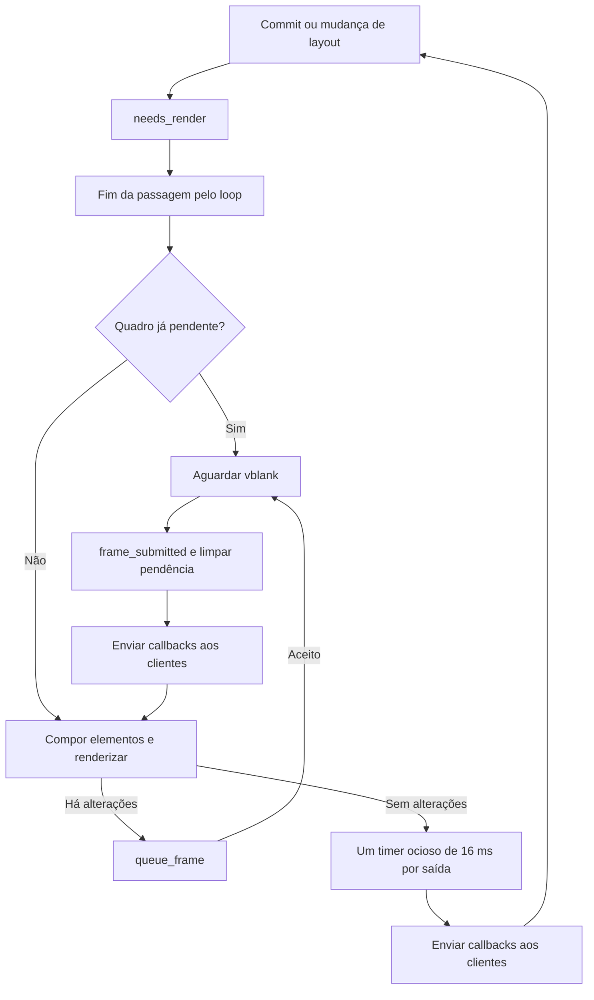

# Diagnóstico do compositor

O compositor grava em `$XDG_STATE_HOME/sparky/logs/compositor.log`, ou em
`~/.local/state/sparky/logs/compositor.log` quando a variável não contém um
caminho absoluto. O diretório usa modo 700 e os arquivos usam modo 600.
Não são registrados ambiente completo, teclas, senhas ou títulos das janelas
pelas novas métricas. Os eventos existentes continuam sujeitos ao `RUST_LOG`.

O arquivo atual tem limite de 2 MiB e há três arquivos anteriores,
`compositor.log.1` a `.3`. Uma nova sessão também rotaciona o arquivo atual,
preservando os registros anteriores dentro dessa retenção. Ao atingir o limite,
o arquivo mais antigo é substituído. Uma trava impede dois compositores de rotacionarem
os mesmos arquivos simultaneamente; a segunda instância usa stderr.

A escrita ocorre numa thread com fila limitada a 128 registros de até 8 KiB.
Um evento maior é truncado e uma fila cheia descarta eventos, incrementando
`dropped_logs`. O loop gráfico não espera espaço na fila nem escreve no disco.
Falhas de arquivo são avisadas no stderr, que também recebe o diagnóstico de
reserva. A thread sincroniza os dados a cada cinco segundos e no encerramento.
O encerramento espera essa thread por no máximo um segundo.
Se a thread não puder ser iniciada, os eventos usam stderr de forma síncrona.

Isso reduz a perda de evidência, mas não garante persistência dos últimos
segundos após falta de energia, reset físico, SIGKILL ou travamento do kernel.
Não configura panic, reinício automático ou parâmetros do sistema.

## Amostras periódicas

A mesma thread grava uma amostra a cada cinco segundos, inclusive quando o
loop Wayland deixa de progredir, desde que a thread e o disco ainda funcionem.
As amostras independem do filtro `RUST_LOG`. Elas identificam PID, versão,
tempo Unix em milissegundos e tempo monotônico desde a inicialização do logger.
Uma mudança no relógio do sistema não altera o tempo monotônico.

| Campo | Interpretação |
|---|---|
| `loop_age_ms` | Tempo desde o fim da última passagem pelo loop; um timer de um segundo mantém a passagem mesmo sem entrada do usuário |
| `phase` | Última fase observada: `Starting`, `Dispatch`, `Render` ou `Queue` |
| `render_calls` | Chamadas concluídas ao caminho de renderização DRM, incluindo quadros vazios e erros |
| `queued` / `presented` | Enfileiramentos aceitos / quadros confirmados pelo DRM após vblank |
| `last_queue_age_ms` / `last_present_age_ms` | Tempo desde o último enfileiramento / confirmação, ou `None` antes do primeiro |
| `idle` / `skipped` / `errors` | Timers ociosos registrados / tentativas sem saída pronta / falhas de renderização, fila ou confirmação |
| `max_render_us` | Maior duração observada, incluindo composição dos elementos e chamada ao Smithay |
| `max_queue_us` | Maior duração de um enfileiramento bem sucedido; não é tempo de execução da GPU |
| `windows` / `outputs` | Janelas conhecidas e saídas do compositor |
| `pending` / `timers` | Saídas com quadro pendente / timer ocioso registrado |
| `rss_kib` / `peak_kib` / `anonymous_kib` | RAM residente, pico residente e parcela anônima do processo |
| `swap_kib` | Swap atribuída ao processo pelo kernel |
| `available_kib` / `swap_free_kib` | Memória disponível e swap livre no sistema inteiro |
| `pressure_some_avg10` / `pressure_full_avg10` | PSI de memória do sistema nos últimos dez segundos |
| `threads` | Threads do processo |

Valores `Some(n)` vieram do kernel; `None` significa indisponível, sem substituir
ausência por zero. RSS é uma estimativa do kernel, não o total de alocações Rust.
As amostras não medem VRAM, memória do ETS2 ou de outros processos individualmente.
Os contadores são cumulativos e agregados entre monitores. As leituras atômicas
são aproximadas, sem bloquear o compositor para produzir um snapshot consistente.
Janelas, saídas, pendências e timers são atualizados pelo loop a cada segundo;
se ele bloquear, esses quatro valores ficam na última leitura bem sucedida.
Os contadores de quadros são do backend DRM; aninhado, não medem o backend winit.

RSS ou pico altos isoladamente não provam vazamento. Compare várias amostras
após abrir e fechar as mesmas janelas, observando principalmente memória anônima,
swap, quantidade de janelas e pressão do sistema. Alocadores e caches podem manter
memória para reutilização. Confirmação de vazamento exige investigação adicional.

## Agendamento atual

O vblank também tenta produzir o próximo quadro diretamente. O timer ocioso
envia callbacks, sem renderizar diretamente. Um commit posterior volta a marcar
`needs_render`. O timer existente é reutilizado enquanto estiver registrado e
é removido ao desconectar a saída. A instrumentação preserva essas decisões.
Erros de renderização/enfileiramento são registrados; não foi acrescentada
uma política nova de tentativas automáticas.

Se `loop_age_ms` crescer e a fase permanecer `Render` ou `Queue`, temos um
indício do ponto onde a passagem parou. Se o loop continuar vivo, `pending`
persistir e `presented` não avançar, investigar apresentação e eventos DRM.
Uma saída estática sem quadro pendente pode ficar sem novas apresentações
normalmente. Correlacione também com suspensão e troca de terminal virtual.
Esses sinais orientam a investigação; não identificam sozinhos
uma falha de driver ou compositor.

Para obter eventos individuais por monitor num próximo login autorizado,
o filtro é `RUST_LOG=info,sparky_compositor::backend::drm::render=trace`.
Ele registra enfileiramento, vblank e timers, com maior volume de logs.
Não execute outro compositor para ativar esse filtro na sessão em uso.

Referências: [memória em /proc](https://docs.kernel.org/filesystems/proc.html),
[PSI](https://docs.kernel.org/accounting/psi.html) e
[writer do tracing](https://docs.rs/tracing-subscriber/latest/tracing_subscriber/fmt/writer/trait.MakeWriter.html).
